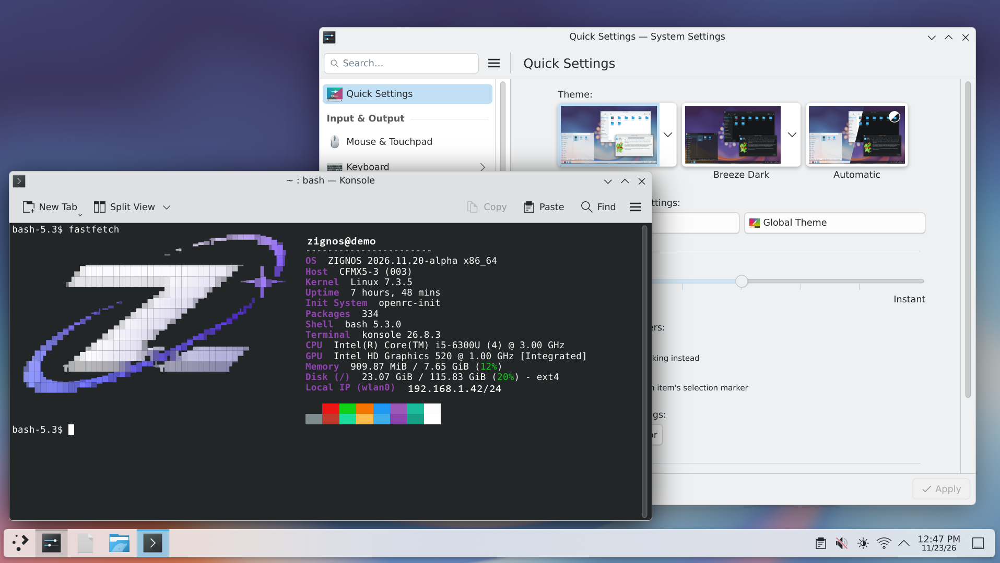

ZIGNOS はコンソール主体の最小ベースとして育ってきましたが、最初のデスクトップ
環境として **KDE Plasma 6 (Wayland)** を導入しています。

**M47 で Stable / Testing / Unstable のデスクトップ系列を実際に分岐し、
M48 で SDDM を全チャンネル、Plasma Login Manager を Testing / Unstable に
追加しました。M50 で Spectacle と kio-extras を加え、M51 で zpkg 0.3.2 の
自己更新と新規依存の自動導入を追加しています。Flatpak / xdg-desktop-portal
にも対応しました。`desktop/` は stable 252 / testing・unstable 260 レシピ、
`kde-applications` は 11 アプリです。
Stable は Qt 6.8.5 / KF6 6.18.0 / Plasma 6.4.6 / Gear 25.04.3、Testing は
Qt 6.11.3 / KF6 6.32 / Plasma 6.8.3 / Gear 26.08.3、Unstable は
Linux 7.4-rc3 と Gear 26.11.80 beta を採用しています。
stage3 と既定のイメージは CLI の最小ベースのままです。**



*Testing チャンネル(Linux 7.3.5 / Plasma 6.8.3)を Intel HD Graphics 520 で動作させた画面。*

## 目標

- Plasma 6 の Wayland セッションで、ログイン → パネル/デスクトップ →
  ターミナル/設定 → ログアウトまでを動作させる
- OpenRC のまま、systemd へ移行しない
- デスクトップは `desktop/` の任意パッケージとし、CLI ベースを肥大化させない
- 日本語表示、NetworkManager、PipeWire、電源管理までを最終形に含める

## チャンネル方針

チャンネルは **Stable = 安定/LTS、Testing = 最新安定版、Unstable = さらに挑戦的**
の3段階です。変更は必ず **Unstable → Testing → Stable** の順に検証し、
逆流させません。

| コンポーネント | Stable(LTS/安定) | Testing(最新安定) | Unstable(挑戦的) |
|---|---|---|---|
| Linux kernel | 6.18.65 LTS | 7.3.6 最新安定 | 7.4-rc3 mainline |
| KDE Plasma | 6.4.6(Qt 6.8 LTS 対応) | 6.8.3 | 6.8.3(6.9 公開待ち) |
| Qt | 6.8.5 LTS | 6.11.3 | 6.11.3(Plasma 6.9 と同時に 6.12) |
| KDE Frameworks | 6.18 | 6.32 | 6.32(6.33 は Plasma 6.9 と同時) |
| KDE Gear(アプリ) | 25.04.3 | 26.08.3 | 26.11.80 beta |
| Wayland | 1.25 | 1.26 | 1.26 |
| Mesa | 26.2.7 | 26.3.1 | 26.3.1(main は実 GPU 検証待ち) |
| セッション | elogind + Linux-PAM + polkit | 同じ | 同じ |
| 音声 | PipeWire + WirePlumber | 最新安定版 | 最新安定版 |
| ログイン | SDDM 0.21 | SDDM 0.21 / PLM 6.8.3 | SDDM 0.21 / PLM 6.8.3 |

- **Stable** は Linux と Qt の LTS を固定し、Plasma / Gear も検証済みの
  安定系列に留めます。長期サポートと保守性を優先します
- **Testing** は Linux / KDE の最新安定版(またはそれに準ずるもの)を採用します
- **Unstable** は Testing よりさらに新しく、RC / beta / mainline / git snapshot を含みます
- 新機能・新バージョンは Unstable → Testing → Stable の順に昇格します
- Stable は LTS ブランチのため、Testing の最新版をそのまま入れるのではなく、
  検証済みの修正を LTS へバックポートします
- `core/linux` と `desktop/` はチャンネルで系列が分岐し、その他の
  `core/` / `main/` は原則共有します

KDE Gear には Plasma のような LTS がありません。そのため Stable では
Qt 6.8 LTS でビルドできる最新の Gear(25.04.3)を固定し、Testing は最新安定版
(26.08.3)、Unstable は次期版(26.11.80 beta)を追従します。

## パッケージ構成

デスクトップ本体と KDE アプリは、別のメタパッケージに分けます。

- **`plasma-meta`** — Plasma セッション本体(kwin / plasma-workspace /
  plasma-desktop / systemsettings / plasma-nm / plasma-pa / powerdevil /
  壁紙 / kirigami-addons / polkit エージェント / UDisks2 など)。KDE アプリは含めません
- **`kde-applications`** — KDE Gear のアプリ。Konsole / Dolphin /
  KCalc / Filelight / Kate / Ark / Gwenview / Okular / KWalletManager /
  Spectacle / kio-extras を収録します。Plasma 本体には依存しません

`plasma-meta` と `kde-applications` は独立してインストール・削除できます。
将来は `kde-applications-{utilities,graphics,multimedia,network,office,pim,sdk}`
のサブメタへ分割できる構成にします。

Flatpak は `flatpak` / `xdg-desktop-portal` / `xdg-desktop-portal-kde` の
3 パッケージで追加します。システムヘルパーは D-Bus アクティベーションで
起動し、ファイル選択・画面共有・印刷は KDE ポータルが処理します。詳細は
[Flatpak](/docs/desktops/flatpak/) を参照してください。

## OpenRC との統合

Plasma の Wayland セッションは、OpenRC 上では次の順序で支えます。

```
dbus → elogind → polkit → upower → display-manager
```

KWin 6 は logind API に依存しており、seatd/libseat は使いません。そのため
OpenRC では **elogind が必須**です。また、セッション作成と画面ロックには
PAM が必要です。M44 で **Linux-PAM を `core` に移し、shadow を PAM 対応**に
しました。コンソールログインが elogind の seat0 セッションを作り、KWin が
DRM を取得できます。

## 実装状況(M43–M51)

2026-11-21 時点で、`desktop/` に次のスタックを追加し、build VM の chroot と
BIOS/MBR の検証イメージ(QEMU)でビルド・起動を確認しています。

- **セッション**: Linux-PAM 1.7.3(core)/ elogind 257.16 / polkit 128。
  shadow は PAM 対応、`/etc/pam.d` に login/su/passwd 等を同梱
- **Wayland**: wayland 1.25 / wayland-protocols 1.49 / libxkbcommon 1.13 /
  xkeyboard-config 2.45
- **入力・DRM**: libdrm 2.4.134 / libevdev / mtdev / libinput 1.32 / pixman
- **フォント**: freetype 2.15 / harfbuzz 15.1 / fontconfig 2.18 / libpng /
  libjpeg-turbo / DejaVu
- **グラフィックス**: libglvnd 1.7 + Mesa 26.2.7(virgl / softpipe / swrast、
  LLVM なし)。DRI megadriver (`dril`)から `virtio_gpu` / `kms_swrast` /
  `swrast` ドライバを導入
- **Qt / KF6 / Plasma**: Qt 6.8.5(qtbase / qtdeclarative / qtwayland /
  qt5compat / qttools / qtpositioning / qtlocation / qtsensors)、
  KF6 6.18.0、Plasma 6.4.6(KWin / plasma-workspace / plasma-desktop /
  systemsettings / kscreenlocker / kactivitymanagerd など)
- **Xwayland**: Xwayland 24.1.9 / xkbcomp 1.4.7 / libXfont2 / libfontenc /
  libxshmfence。ksmserver は Wayland でも xcb を要求するため必須
- **QEMU 検証**: virtio-gpu + TCG + `noapic` で起動し、tty1 の PAM ログイン →
  elogind セッション(seat0)→ `startplasma-wayland` → KWin(DRM)→ Xwayland →
  ksmserver → plasmashell を確認。QMP のスクリーンショットでパネルと
  デスクトップを確認しました(GPU は `kms_swrast` のソフトウェア GL)

### M45 で追加したもの

- **音声**: ALSA 1.2.16 / libpulse 17.0 / PipeWire 1.6.7 / WirePlumber 0.5.19 /
  pulseaudio-qt 1.7.0 / plasma-pa 6.4.5。PipeWire は Plasma の XDG autostart から
  `pipewire` + `pipewire-pulse` + WirePlumber を起動。QEMU の HDA で
  `pactl` の既定 sink を確認
- **ネットワーク/電源**: NetworkManager の polkit 化、plasma-nm、
  UPower 1.91.5 + OpenRC サービス、powerdevil 6.4.5
- **アプリ/設定**: kirigami-addons、壁紙、polkit-kde-agent、
  Konsole / Dolphin / KCalc / Filelight 25.04.3
- **グラフィックス**: libglvnd の X11/GLX、Mesa の `glx=dri`、Xwayland の
  `glx=true`。Xwayland 上で GLX 1.4 を確認
- **kcm_style**: xrdb を追加し、kcminit フックを復帰
- **PAM**: linux-pam に system-login / system-local-login を追加し、
  コンソール/SSH ログインを確認

### M46 で追加したもの

- **UDisks2**: libatasmart 0.19 / libblockdev 3.2.2(part / fs / loop / swap /
  mdraid / crypto / nvme)/ udisks2 2.10.2。暗号・NVMe のため cryptsetup 2.8.8 /
  LVM2 2.03.44 / libnvme 1.16.2 / json-c 0.19 / keyutils 1.6.3 /
  libbytesize 2.12 を追加し、`plasma-meta` に UDisks2 を含めています
- **アプリ**: Ark(libarchive 3.8.11)、Kate、Gwenview(Exiv2 / LCMS2 /
  kImageAnnotator / kColorPicker)、Okular(Poppler 25.04.0 の Qt6 frontend)、
  KWalletManager。`kde-applications` は 9 アプリになりました
- **確認**: chroot で UDisks2 の D-Bus 起動と `udisksctl status`、各アプリの
  `--version` と offscreen 起動を確認
- **検証イメージ**: `zignos-m46.img`(BIOS/MBR、16 GiB sparse / 実使用 8.8 GiB)を
  QEMU で起動し、tty1 の PAM ログイン → `startplasma-wayland`(kms_swrast)で
  壁紙・パネルを確認。Kate / Ark / Gwenview / Okular / KWalletManager の
  ウィンドウと `udisksctl status`(vda / sr0)も動作。開発ツールを含む検証用です
- **クリーンな検証イメージ**: stage3 の root に `plasma-meta` /
  `kde-applications` を binpkg から入れた 291 パッケージの
  `zignos-m46-clean.img`(BIOS/MBR、10 GiB sparse / 実使用 6.4 GiB)も生成。
  QEMU で壁紙・パネル・時計、Kate / Ark / Dolphin、UDisks2 を確認しました。
  クリーン root で見つかった実行時依存の欠落(libltdl、Xwayland、xkbcomp、
  DejaVu フォント、breeze-icons、frameworkintegration ほか)はレシピに反映済みです。
  MIME データベース用に `shared-mime-info 2.4` も追加し、Dolphin の
  ファイル種別/アイコン表示が直りました。日本語フォントは IPAex Gothic /
  Mincho を `ipaex-fonts` として追加し、Kate で日本語が正しく表示されることを
  確認しました

### M47 で分岐したもの

- **Stable**: Linux 6.18.65 LTS / Qt 6.8.5 / KF6 6.18 / Plasma 6.4.6 /
  Gear 25.04.3 / Mesa 26.2.7。既存の安定系列を維持
- **Testing**: Linux 7.3.6 / Qt 6.11.3 / KF6 6.32 / Plasma 6.8.3 /
  Gear 26.08.3 / Mesa 26.3.1。QEMU でパネル・壁紙・KRunner・Dolphin・Kate・
  UDisks2(vda / sr0)まで確認し、未解決 soname 0
- **Unstable**: Linux 7.4-rc3 / Gear 26.11.80 beta。Qt 6.12・KF6 6.33・
  Plasma 6.9 は Plasma 6.9 と同時に移行するため、現時点では Testing と同じ
  Qt 6.11.3 / KF6 6.32 / Plasma 6.8.3 / Mesa 26.3.1 を使用
- **新規依存**: Union(libplasma のスタイルエンジン)、libkexiv2(壁紙の EXIF)、
  libssh(Konsole)、qtkeychain(plasma-nm)、kholidays / knighttime、
  vulkan-headers / vulkan-loader(KWin)、QCoro 0.13
- **移行修正**: Plasma 6.8 の SOVERSION 変更に合わせた再ビルド、6.4 の空
  plasmoid ディレクトリ掃除、DRM 用 `video` / `render` グループ、
  `unix_chkpwd` の setgid と `/etc/shadow` の `root:shadow 0640` 化
- **Unstable の QEMU 検証**: Linux 7.4-rc3 の起動、Qt / KF6 / Plasma /
  Gear 26.11.80 のビルド、未解決 soname 0 を確認。KWin は QEMU の softpipe
  (`sp_find_cached_tile`)で segfault するため、デスクトップの目視確認は
  Testing 側で行いました。実 GPU または Plasma 6.9 投入時に再検証します

### M48 で追加したもの

- **SDDM 0.21.0-r7** — 全チャンネルの `plasma-meta` に追加。Stable は
  Qt 6.8.5、Testing / Unstable は Qt 6.11.3 でビルド。Wayland greeter は
  `kwin_wayland --drm`、`sddm` ユーザー(620)と `/var/lib/sddm` は
  initscripts と post_install が用意します
- **Plasma Login Manager 6.8.3-r2** — Testing / Unstable に追加。上流の
  systemd user unit を使わず、`dbus-run-session` の下で `kwin_wayland` と
  `plasma-login-greeter` を起動する OpenRC wrapper に置き換えています。
  PAM、`plasmalogin` ユーザー(621)、VT7 を使います
- **共通 D-Bus ポリシー** — SDDM と PLM が同じ
  `org.freedesktop.DisplayManager.conf` を所有して衝突していたため、
  initscripts r25 に移しました
- **補助グループの修正** — SDDM / PLM の helper が root の ambient groups を
  セッションへ渡し、greeter とユーザーに gid 0(root)が混入する問題を
  パッチで修正しました。`video` / `render` は `/etc/group` から付与されます
- **カーソル** — `XCURSOR_THEME=breeze_cursors` を既定にしました。ZIGNOS には
  汎用の `default` カーソルテーマがないため、未設定だと KWin が警告を出します
- **VT** — SDDM 0.21 は `MinimumVT` を廃止し、最初の空き VT を使います。
  `console` getty が tty1 を掴んで `HELPER_TTY_ERROR` になる場合は
  `rc-update del console default` で tty1 を空けます。PLM は VT7 です

SDDM / PLM とも、daemon 起動、PAM による greeter セッション作成、KWin の
DRM 起動までを QEMU で確認しました。ただし QEMU の `virtio-vga` +
`kms_swrast` では、透過ウィンドウの合成時に Mesa softpipe の
`sp_find_cached_tile` で KWin が segfault します(Mesa 26.2.7 / 26.3.1 の
両方)。greeter の表示とログインの目視確認は実 GPU、または softpipe 修正後の
QEMU で行います。通常の Plasma ユーザーセッション(不透明なデスクトップ)は
同じ Mesa でも動作します。

### M49–M51 で追加したもの

- **M49: レシピ同期** — `zpkg sync --git` が `.zpkg-git` の commit と
  リモート HEAD を比較し、変更時だけ shallow clone します。stage3 の
  `/etc/zpkg/sync.conf` は既定で GitHub の `zignos-recipes` を参照します
- **M50: Spectacle / kio-extras** — stable は Spectacle 6.4.6 + OpenCV
  4.14.0(core/imgproc)、Testing / Unstable は Spectacle 6.8.3 +
  KQuickImageEditor 0.7.0.1 / Tesseract 5.5.4。OCR 用に eng / jpn /
  jpn_vert / osd の tessdata を同梱します。kio-extras は stable 25.04.3 /
  Testing 26.08.3 / Unstable 26.11.80 で、archive / fish / info / man /
  thumbnail / recentlyused / 検索などの worker を提供します。録画用に
  FFmpeg 8.0.3(stable)/ 8.1.3(testing・unstable)と libva 2.24.1 を
  KPipeWire に追加しました
- **M51: 更新システム** — zpkg 0.3.2 はソースアーカイブをレシピに同梱し、
  通常システムでも自己更新できます。`zpkg upgrade` は新しく必要になった
  依存を先にインストールしてから、既存パッケージを更新します。initscripts
  r27 は既定の git モード sync.conf に必要な `git` を依存に追加しました

## 導入

stage3 からデスクトップを入れる例です。サービスは opt-in なので、必要なものを
自分で有効化します。

```sh
zpkg install plasma-meta kde-applications
rc-update add networkmanager default
rc-update add upower default
# グラフィカルログイン。どちらか一方だけを有効にする
rc-update add sddm default          # SDDM (全チャンネル)
# rc-update add plasmalogin default # PLM (testing / unstable)
```

## フェーズ

| # | 内容 |
|---|---|
| M42 | 設計調査(完了) |
| M43 | 基盤(PAM / elogind / polkit / Wayland / Mesa / フォント / Qt6)+ メタレシピ骨格(完了) |
| M44 | KF6 + KWin + Plasma 最小 + `plasma-meta`(完了。QEMU でパネル/デスクトップ表示) |
| M45 | フル Plasma(音声 / ネットワーク / 電源 / 設定 / アプリ)+ `kde-applications`(完了。QEMU で確認) |
| M46 | UDisks2 / KDE アプリ拡張 / 検証イメージ(第1増分完了)。配布用 ISO・UEFI / 実機 GPU は次の増分 |
| M47 | Stable / Testing / Unstable の系列分岐(完了)。Testing は Qt 6.11 / Plasma 6.8 / Gear 26.08、Unstable は Linux 7.4-rc3 と Gear 26.11.80 beta。Qt 6.12 / Plasma 6.9 は次期 |
| M48 | SDDM を全チャンネル、PLM を Testing / Unstable に追加(完了)。helper の root グループ混入と共通 D-Bus ポリシーを修正。greeter の目視は QEMU softpipe のため実 GPU 待ち |
| M49 | レシピ同期の git 化(完了)。`zpkg sync --git` と `/etc/zpkg/sync.conf` の既定 GitHub リポジトリ、stage3 r20 |
| M50 | Spectacle / kio-extras を全チャンネルに追加(完了)。stable は Spectacle 6.4.6 + OpenCV、Testing / Unstable は 6.8.3 + KQuickImageEditor / Tesseract。KPipeWire 用に FFmpeg / libva を追加 |
| M51 | zpkg の自己更新と新規依存の自動導入(完了)。zpkg 0.3.2 / initscripts r27 |

各フェーズの完了条件と依存関係は [ロードマップ](/docs/roadmap/) に記録します。

## 検証方針

QEMU の virtio-gpu と Wayland を使い、DRM/seat を含む実際のセッション起動を
確認します。

- QEMU に virtio-gpu、virtio-keyboard、virtio-tablet を追加
- elogind の PAM セッションから `startplasma-wayland` を起動
- スクリーンショットと入力イベントでパネル/デスクトップ/設定画面を確認
- `loginctl` のセッション状態と KWin のログを確認

実機 GPU(Intel / AMD)での検証は、QEMU で基盤が安定した後に行います。

## 現在の制限

- `desktop/` は stable 212 / Testing・Unstable 220 レシピ。`kde-applications` は
  Konsole / Dolphin / KCalc / Filelight / Kate / Ark / Gwenview / Okular /
  KWalletManager / Spectacle / kio-extras の 11 アプリ
- Spectacle は stable 6.4.6(OpenCV core/imgproc)、Testing / Unstable 6.8.3
  (KQuickImageEditor / Tesseract)。録画のソフトウェア VP8/VP9/H.264
  エンコーダ(libvpx / openh264)は未導入で、VAAPI のある GPU か
  エンコーダ追加後に利用する。撮影・録画・OCR の GUI 操作は実 GPU で確認する。
  OCR 用の言語データは eng / jpn / jpn_vert / osd を同梱する
- kio-extras は archive / fish / info / man / thumbnail / recentlyused /
  検索などの worker を提供する。Samba / MTP / AFC / NFS は未導入のため無効
- 日本語表示は IPAex Gothic / Mincho で対応済み(UI の翻訳は英語のまま。
  日本語ロケールの UI 翻訳は未対応)
- SDDM 0.21 は全チャンネル、PLM 6.8.3 は Testing / Unstable に導入済み。
  両方とも QEMU の Mesa softpipe で greeter の KWin が落ちるため、
  画面表示とログインの目視確認は実 GPU 待ち
- SDDM と PLM は同時に有効化しない。SDDM が tty1 を取れない場合は
  `rc-update del console default` で console getty を止める
- Xwayland の GLX は有効(Mesa の `libGL` / `libGLX_mesa`)。実機 GPU での
  確認は残っています
- PipeWire の Bluetooth / RTKit 連携は未導入
- デスクトップ入りイメージは BIOS/MBR の検証用 2 種のみ(開発ツール入りと、
  stage3 から入れたクリーンな 291 パッケージ版)。配布用 ISO と UEFI 版、
  初回セットアップは次の増分

設計・実装の詳細は、リポジトリ内の `zignos/docs/desktop-kde.md` にあります。
