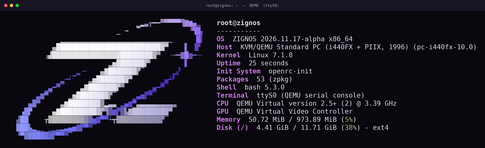

ZIGNOS の実機インストールは、**stage3 tarball をディスクへ展開し、chroot の中で
カーネルと GRUB を入れる方法を既定**とします。ベースは意図的に最小構成なので、
このガイドでは「何が入っていないか」と「何を自分で入れるか」も含めて説明します。

- **既定: stage3 tarball**(このガイドの 2〜9 章)
- 代替: ZIGNOS イメージから `zignos-install` でコピー(10 章 A)
- 代替: イメージを直接 `dd`(10 章 B)
- レスキュー: SystemRescue から chroot(10 章 C)

> **注意**: `<DISK>` は `/dev/nvme0n1` や `/dev/sda` などの**ディスク全体**、
> `<PART>` は `nvme0n1p1` / `sda1` などのパーティションです。コマンドを実行すると
> 対象ディスクの全データが消えます。必ず `lsblk` で確認してください。

## 対応ファームウェア

| ファームウェア | ディスク | GRUB | 備考 |
|---|---|---|---|
| **UEFI**(既定) | GPT + ESP(FAT32)+ ext4 root | `x86_64-efi` + efibootmgr | Secure Boot は無効化 |
| BIOS/CSM | MBR + ext4 root | `i386-pc` | 2 TiB 超のディスクは不可 |

---

## 1. SystemRescue を用意する

実機作業は **SystemRescue** から行います。BIOS/UEFI の両方で起動でき、
`sfdisk` / `mkfs` / `tar` / `chroot` / `efibootmgr` が揃っています。

- 公式: <https://www.system-rescue.org/>
- 2026-11-17 時点の最新: **SystemRescue 13.03**
- USB メモリは 2 GiB 以上

### USB へ書き込む

```sh
# ダウンロードと検証(例)
curl -LO https://fastly-cdn.system-rescue.org/releases/13.03/systemrescue-13.03-amd64.iso
curl -LO https://fastly-cdn.system-rescue.org/releases/13.03/systemrescue-13.03-amd64.iso.sha256
sha256sum --check systemrescue-13.03-amd64.iso.sha256

# USB へ書き込み(/dev/sdX は USB 全体。間違えるとディスクを壊す)
sudo dd if=systemrescue-13.03-amd64.iso of=/dev/sdX bs=4M status=progress conv=fsync
sync
```

### 起動

1. USB を挿してファームウェアの起動メニューを開く
2. **UEFI 機は UEFI モード**(CSM 無効)、BIOS 機はレガシーモードで起動
3. **Secure Boot を無効**にする(ZIGNOS の GRUB/カーネルは未署名)
4. 起動後、有線 LAN は自動で DHCP。WiFi は `nmtui` で設定

---

## 2. ディスクを準備する

> **初心者には `cfdisk` を推奨します。** 対話式でパーティションを確認しながら
> 作成・削除できるため、`sfdisk` のスクリプトを打ち間違える心配がありません。
> 慣れている人向けの `sfdisk` 一括作成も 2.4 に残しています。

まず対象ディスクを確認します。**以降の操作でディスクの全データが消えます。**

```sh
lsblk -o NAME,SIZE,MODEL,TYPE
```

`<DISK>` は `/dev/nvme0n1` や `/dev/sda` などの**ディスク全体**です。
パーティション名は NVMe が `<DISK>p1`、SATA が `<DISK>1` になります。

### 2.1 レイアウト例

#### UEFI + GPT

| マウントポイント | パーティション | パーティションタイプ | 容量 |
|---|---|---|---|
| `/mnt/zignos/boot/efi` | `<DISK>p1` | EFI システムパーティション(FAT32) | **512 MiB**(最低 300 MiB。複数カーネルなら 1 GiB) |
| `[スワップ]`(任意) | `<DISK>p2` | Linux swap | 512 MiB 以上 |
| `/mnt/zignos` | `<DISK>p3` | Linux x86-64 root(/) | 残りすべて |

#### BIOS + MBR

| マウントポイント | パーティション | パーティションタイプ | 容量 |
|---|---|---|---|
| `[スワップ]`(任意) | `<DISK>1` | Linux swap | 512 MiB 以上 |
| `/mnt/zignos` | `<DISK>2` | Linux | 残りすべて |

- **スワップは必須ではありません。** ハイバネーションを使う場合やメモリが
  少ない場合に作成します。後からスワップファイルで追加することもできます
- スワップを作らない場合、root は UEFI が `<DISK>p2`、BIOS が `<DISK>1` に
  なり、以降の例の番号を 1 つずつ前に読み替えてください
- ESP は **512 MiB** を推奨します。ZIGNOS は `/boot/vmlinuz-<ver>` と
  `initramfs-<ver>.img` のコピーを置くため、複数カーネルを保持するなら 1 GiB
- BIOS/MBR は **2 TiB 超のディスク**を扱えません。可能なら UEFI/GPT を使ってください
- Secure Boot は無効にします(ZIGNOS の GRUB/カーネルは未署名)

### 2.2 cfdisk で作る(推奨)

```sh
cfdisk <DISK>
```

1. UEFI なら **`gpt`**、BIOS なら **`dos`** を選ぶ
2. `[New]` → `512M` → UEFI では type を **`EFI System`** にする
3. スワップを作るなら `[New]` → `512M` → type を **`Linux swap`** にする
4. `[New]` → 残り全部 → type を **`Linux filesystem`**(BIOS は `Linux`)にする
   BIOS では root パーティションを選んで **`[Bootable]`** も付ける
5. `[Write]` → `yes` で書き込み、`[Quit]` で終了
6. カーネルにパーティションテーブルを再読込させる

```sh
partx -u <DISK>
# 反映されない場合
partprobe <DISK>
```

> `cfdisk` は起動直後に既存のパーティションテーブルを表示します。別の OS や
> データが残っているディスクでは、**書き込む前に `lsblk` と表示内容を必ず確認**
> してください。既存の署名が残って `mkfs` が拒否する場合は
> `wipefs -a <DISK>` で消去できます(全データが消えます)。

### 2.3 フォーマットしてマウントする

#### UEFI + GPT

スワップ無し(最小構成):

```sh
mkfs.vfat -F32 -n ZIGNOSESP <DISK>p1
mkfs.ext4 -L zignos-root <DISK>p2

mkdir -p /mnt/zignos/boot/efi
mount <DISK>p2 /mnt/zignos
mount <DISK>p1 /mnt/zignos/boot/efi
```

スワップ有り(root は p3):

```sh
mkfs.vfat -F32 -n ZIGNOSESP <DISK>p1
mkswap <DISK>p2
swapon <DISK>p2
mkfs.ext4 -L zignos-root <DISK>p3

mkdir -p /mnt/zignos/boot/efi
mount <DISK>p3 /mnt/zignos
mount <DISK>p1 /mnt/zignos/boot/efi
```

#### BIOS + MBR

スワップ無し(最小構成):

```sh
mkfs.ext4 -L zignos-root <DISK>1
mount <DISK>1 /mnt/zignos
```

スワップ有り(root は 2):

```sh
mkswap <DISK>1
swapon <DISK>1
mkfs.ext4 -L zignos-root <DISK>2
mount <DISK>2 /mnt/zignos
```

スワップを `/etc/fstab` に残す場合は、`blkid` で UUID を確認して次の行を追加します。

```
UUID=<swap の UUID> none swap sw 0 0
```

### 2.4 sfdisk で一括作成する(上級者向け)

スワップ無しの最小構成を一括で作る例です。スワップが必要なら `cfdisk` で
追加するか、`sfdisk` の行を増やしてください。

#### UEFI + GPT

```sh
sfdisk <DISK> <<'EOF'
label: gpt
start=2048, size=1048576, type=C12A7328-F81F-11D2-BA4B-00A0C93EC93B, name="ZIGNOS ESP"
start=1050624, type=0FC63DAF-8483-4772-8E79-3D69D8477DE4, name="zignos-root"
EOF
partx -u <DISK>

mkfs.vfat -F32 -n ZIGNOSESP <DISK>p1
mkfs.ext4 -L zignos-root <DISK>p2

mkdir -p /mnt/zignos/boot/efi
mount <DISK>p2 /mnt/zignos
mount <DISK>p1 /mnt/zignos/boot/efi
```

#### BIOS + MBR

```sh
sfdisk <DISK> <<'EOF'
label: dos
start=2048, type=83, bootable
EOF
partx -u <DISK>

mkfs.ext4 -L zignos-root <DISK>1
mount <DISK>1 /mnt/zignos
```

---

## 3. stage3 tarball を用意する

stage3 は「カーネルと GRUB を除いた最小ベース」です。公開済みの最新は
**2026.11.19-alpha / stage3 r12**、開発ツリーの最新は
**2026.11.20-alpha / stage3 r15(55 パッケージ / 約 976 MiB)** です。
r15 は `linux-pam` r3(`system-login` / `system-local-login` を含む)、
initscripts r20、WiFi 修正(`networkmanager-wifi`)を含みますが、このページの
時点では公開準備中です。公開後はダウンロードページの tarball を使えます。

開発者向けには build VM で生成します。

```sh
# ビルドホストの作業ツリー内
sudo OUT=/var/tmp/zignos-stage3-20261120-r15-x86_64.tar.xz ./make-stage3.sh
sha256sum /var/tmp/zignos-stage3-20261120-r15-x86_64.tar.xz \
  > /var/tmp/zignos-stage3-20261120-r15-x86_64.tar.xz.sha256
```

生成物を USB / SSH で実機へ運び、**展開前にチェックサムを検証**します。

```sh
sha256sum --check zignos-stage3-20261120-r15-x86_64.tar.xz.sha256
```

> **公開済み(r12)**: {{build_date}} 時点で **{{stage3.package_count}} パッケージ /
> 約 {{stage3.size_mib}} MiB**。ファイル名は `{{stage3.filename}}`、SHA-256 は
> `{{stage3.sha256}}` です。
>
> **開発ビルド(r15)**: 2026-11-20 / **55 パッケージ / 約 976 MiB**。
> ファイル名は `zignos-stage3-20261120-r15-x86_64.tar.xz`、SHA-256 は
> `0f54ff44cae3491b77282583bbf326667d1f603bc24116c8283895723feeaac0`。
> r15 は `linux-pam` r3(`system-login` / `system-local-login` を含む)と、
> WiFi 用の `networkmanager-wifi` レシピを同梱します。
>
> root はロック済み、SSH ホスト鍵・machine-id・ユーザーは含みません。

---

## 4. stage3 を展開する

```sh
tar -xpf zignos-stage3.tar.xz -C /mnt/zignos
```

`/etc/resolv.conf` はビルド環境のものが入っているため、実機のネットワークに
合わせて上書きします(SystemRescue の 127.0.0.53 スタブは chroot では使えません)。

```sh
printf 'nameserver 1.1.1.1\nnameserver 8.8.8.8\n' > /mnt/zignos/etc/resolv.conf
```

---

## 5. chroot に入る

stage3 には `zignos-enter.sh` は含まれていません。手動でマウントして入るのが確実です。
**UEFI では `/sys` を rbind して efivarfs を chroot から見えるようにします**
(efibootmgr が NVRAM を読み書きするため)。

```sh
mkdir -p /mnt/zignos/{dev,proc,sys,run}
mount --rbind /dev /mnt/zignos/dev
mount --make-rslave /mnt/zignos/dev
mount -t proc proc /mnt/zignos/proc
mount --rbind /sys /mnt/zignos/sys
mount --make-rslave /mnt/zignos/sys
mount --rbind /run /mnt/zignos/run
mount --make-rslave /mnt/zignos/run

chroot /mnt/zignos /bin/bash -l
```

`zignos-enter.sh` を使う場合は、UEFI のときだけ `/sys` の rbind を
手動で追加してください(ヘルパーは sysfs を新規マウントするため efivarfs が
見えないことがあります)。

> ビルドを bubblewrap で隔離する場合、素の `chroot` では `pivot_root` が使えず
> `auto` が警告して直接ビルドにフォールバックします。`zignos-enter.sh` は private
> mount namespace 内で root を bind mount してから chroot するため、stage3 の
> ディレクトリ chroot でもサンドボックスが動きます。

chroot に入ったら、まず root のパスワードを設定します(stage3 ではロック済み)。

```sh
passwd
```

---

## 6. ベースの初期設定

stage3 にはエディタ・DHCP・SSH・man がありません。設定ファイルは `cat` の
ヒアドキュメントで作れます(必要なら後で `zpkg install vim nano`)。

### ホスト名

```sh
echo zignos > /etc/hostname
```

### タイムゾーン

`tzdata` は入っています。既定は UTC です。

```sh
ln -sf /usr/share/zoneinfo/Asia/Tokyo /etc/localtime
date
```

### キーボード(必要な場合)

```sh
loadkeys jp106
cat > /etc/conf.d/keymaps <<'EOF'
keymap="jp106"
EOF
rc-update add keymaps boot
```

### fstab

stage3 には `/usr/sbin/zignos-fstab` が入っています。レスキュー環境から
対象 root を `/mnt/zignos` にマウントした状態で実行すると、実際のマウント
情報から `/` と(マウント済みなら)`/boot/efi` の行を生成します。

```sh
/mnt/zignos/usr/sbin/zignos-fstab /mnt/zignos
```

手で書く場合は UUID を `blkid` で確認します。UEFI では ESP も fstab に
登録しておくと、`grub-install` やカーネル更新時に `/boot/efi` が使えます。

```sh
blkid <ROOT-PART>  # root の UUID(例: UEFI + スワップ有り = <DISK>p3)
blkid <DISK>p1     # ESP の UUID(UEFI のみ)

cat > /etc/fstab <<EOF
UUID=<ROOT-UUID> / ext4 defaults 0 0
UUID=<ESP-UUID> /boot/efi vfat defaults 0 0
proc  /proc proc  defaults 0 0
sysfs /sys  sysfs defaults 0 0
EOF
```

**重要**: `/` の行の UUID / デバイスが実際と違うと、起動時に `/` が
**read-only のまま**になります。OpenRC の `root` サービスは fstab を
使って remount するため、間違った UUID では remount に失敗します
(サービス自体は `started` と表示されます)。手で書いた場合は
`findmnt -no SOURCE /mnt/zignos` と `blkid` を必ず照合してください。

BIOS の場合は ESP の行を削除します。`/boot/efi` を常時マウントしたくない場合は
ESP の行をコメントアウトしても構いません(GRUB 導入時だけマウントします)。

---

## 7. カーネルを導入する

```sh
zpkg install linux
```

- `x86_64-generic.config` でビルドされ、`/boot/vmlinuz`、`/boot/initramfs.img`、
  `/usr/lib/modules/7.1.8` が入ります
- 初回はソースをダウンロードしてビルドするため **数分〜十数分**かかります
- 設定を変える場合は
  `/usr/share/zignos/recipes/stable/core/linux/x86_64-generic.config` を編集し、
  `zpkg install -f linux` で再ビルドします

```sh
ls -l /boot/vmlinuz /boot/initramfs.img
ls /usr/lib/modules
```

---

## 8. GRUB を導入する

### UEFI(既定。efibootmgr を使う)

GRUB の `uefi` USE フラグを有効にすると、**efibootmgr と efivar が依存として
自動で入ります**。これが以前の「フォールバックパスに置くだけ」より簡単な点です。

```sh
# UEFI 用にビルド(efibootmgr/efivar も依存で入る)
zpkg use --package grub uefi
zpkg install linux grub

# x86_64-efi モジュールと efibootmgr を確認
ls /usr/lib/grub/x86_64-efi
command -v efibootmgr
```

> すでに GRUB を入れてしまった場合は、USE を変えたあと
> `zpkg upgrade grub` または `zpkg install -f grub` で再ビルドしてください。

`/etc/default/grub` を作ります(シリアルコンソールも有効にする例)。

```sh
cat > /etc/default/grub <<'EOF'
GRUB_DISTRIBUTOR="ZIGNOS"
GRUB_TIMEOUT=5
GRUB_DEFAULT=0
GRUB_CMDLINE_LINUX_DEFAULT="console=tty0 console=ttyS0"
GRUB_CMDLINE_LINUX=""
GRUB_TERMINAL="console serial"
GRUB_SERIAL_COMMAND="serial --unit=0 --speed=115200"
EOF
```

ESP が `/boot/efi` にマウントされていることを確認して、GRUB をインストールします。

```sh
mountpoint /boot/efi || mount <DISK>p1 /boot/efi

/usr/sbin/grub-install \
  --target=x86_64-efi \
  --efi-directory=/boot/efi \
  --bootloader-id=ZIGNOS \
  --recheck

/usr/sbin/grub-mkconfig -o /boot/grub/grub.cfg
```

> `grub-mkconfig` が `Found linux image: /boot/vmlinuz-7.1.8` を表示することを
> 確認してください。出ない場合は「GRUB のメニューに ZIGNOS が出ない」を参照。

`grub-install` は efibootmgr が使える環境なら **NVRAM エントリまで自動で作ります**。
確認します。

```sh
efibootmgr -v
```

`Boot####` に `ZIGNOS` があり、`\EFI\ZIGNOS\grubx64.efi` を指していれば完了です。
`BootOrder` の先頭に来ていない場合は、`Boot####` の番号を確認して設定します。

```sh
# 例: ZIGNOS が Boot0003 の場合
efibootmgr --bootorder 0003,0000
```

自動登録されなかった場合(または `--no-nvram` で入れた場合)は、手動で追加します。

```sh
efibootmgr --create \
  --disk <DISK> --part 1 \
  --label ZIGNOS \
  --loader '\EFI\ZIGNOS\grubx64.efi'

efibootmgr -v
```

- `--part 1` は **ESP のパーティション番号**です(NVMe でも `1`)
- `--loader` はバックスラッシュで書きます(シェルではシングルクォート)
- `efibootmgr` が「EFI variables are not supported」と言う場合は、UEFI モードで
  起動していないか、chroot に efivarfs が見えていません。SystemRescue を UEFI で
  起動し直し、`/sys` を rbind してからやり直してください

フォールバック(`/EFI/BOOT/BOOTX64.EFI`)も置きたい場合は、NVRAM が消えたとき用に
スタンドアロン版を作れます(必須ではありません)。

```sh
/usr/bin/grub-mkstandalone -O x86_64-efi \
  -o /boot/efi/EFI/BOOT/BOOTX64.EFI \
  --modules="part_gpt part_msdos fat ext2 normal search search_fs_uuid linux echo serial terminal" \
  "boot/grub/grub.cfg=/boot/grub/grub.cfg"
```

### BIOS(MBR)

```sh
zpkg use --package grub bios
zpkg install linux grub

cat > /etc/default/grub <<'EOF'
GRUB_DISTRIBUTOR="ZIGNOS"
GRUB_TIMEOUT=5
GRUB_CMDLINE_LINUX_DEFAULT="console=tty0 console=ttyS0"
GRUB_TERMINAL="console serial"
GRUB_SERIAL_COMMAND="serial --unit=0 --speed=115200"
EOF

/usr/sbin/grub-install --target=i386-pc --boot-directory=/boot <DISK>
/usr/sbin/grub-mkconfig -o /boot/grub/grub.cfg
```

---

## 9. 初回起動前の仕上げ

### 一般ユーザー

```sh
useradd -m -G wheel -s /bin/bash yourname
passwd yourname
```

`wheel` グループは initscripts が提供します。特権昇格は base では `su` のみです。
`doas` を使うなら:

```sh
zpkg install doas
```

### SSH(任意)

```sh
zpkg install openssh
rc-update add sshd default
install -d -m700 -o yourname -g yourname /home/yourname/.ssh
# /home/yourname/.ssh/authorized_keys を 600 で置く
```

`sshd` は root ログインを無効にして起動します。コンソールの root は復旧用に残ります。

### ネットワーク(任意)

stage3 には DHCP クライアントも NetworkManager も入っていません。
次の **A か B のどちらか**を選びます。

#### A. dhcpcd + wpa_supplicant(最小構成)

有線:

```sh
zpkg install dhcpcd
rc-update add dhcpcd boot
```

WiFi は firmware と supplicant が必要です。

```sh
zpkg install wpa_supplicant iw linux-firmware
rc-update add wpa_supplicant default
# /etc/conf.d/wpa_supplicant の WPA_IFACE(既定 wlan0)を必要なら変更
```

`linux-firmware` は約 2 GiB あります。必要なファームウェアだけを入れる運用も可能です。

#### B. NetworkManager(nmcli / nmtui)

有線・WiFi をまとめて管理したい場合の選択肢です。NetworkManager は main
パッケージなので stage3 には含まれません。

```sh
zpkg install networkmanager-wifi
rc-update add networkmanager default
```

`networkmanager-wifi` は **NetworkManager + wpa_supplicant + iw +
linux-firmware** をまとめて入れるメタパッケージです。ファームウェアを入れ忘れて
WiFi が認識されない事故を避けるため、WiFi を使う場合はこちらを使ってください。
有線専用なら `zpkg install networkmanager` だけでも構いません。

> `networkmanager-wifi` は **stage3 r13 以降**に同梱されています(現行の開発ビルドは r15)。r12 の場合は
> `zpkg install networkmanager wpa_supplicant iw linux-firmware` を使ってください。
>
> **WiFi しか使えない機体**では、この chroot の中で WiFi スタックまで入れてから
> 再起動すると確実です。chroot は SystemRescue のネットワークをそのまま使えるため、
> ここで linux-firmware(約 1 GiB のダウンロード / 約 2 GiB のインストール)を
> 取得できます。

`nmtui` と `nmcli` が入ります。まず TUI で接続する場合:

```sh
nmtui
```

CUI で操作する場合:

```sh
nmcli general status
nmcli device status
nmcli device wifi list
nmcli device wifi connect "<SSID>" password "<PASSWORD>"
```

NetworkManager は内部 DHCP と wpa_supplicant 連携を使うため、**dhcpcd と
wpa_supplicant のサービスは有効化しないでください**(A と B の併用は避ける)。

WiFi が見えないときは、まずデバイスとファームウェアを確認します。

```sh
ip link                     # wlan0 / wlp* があるか
iw dev
rfkill list                 # Soft blocked / Hard blocked
dmesg | grep -i -E 'iwlwifi|firmware'
```

`Direct firmware load ... failed` が出る場合は `linux-firmware` が未導入です
(`zpkg install networkmanager-wifi` で入ります)。Intel Wireless-AC 8260
(`8086:24f3`)は `iwlwifi` + `iwlwifi-8000C-36.ucode` で動作します。

### chroot を抜けて再起動

```sh
exit

umount -R /mnt/zignos/dev
umount -R /mnt/zignos/sys
umount -R /mnt/zignos/run
umount /mnt/zignos/proc
umount /mnt/zignos/boot/efi 2>/dev/null || true
umount /mnt/zignos
sync
reboot
```

ファームウェアの起動メニューで **ZIGNOS** を選びます。UEFI で NVRAM 登録が
うまくいっていない場合は、USB を抜いて再起動し、ファームウェアの一時起動メニューから
`\EFI\ZIGNOS\grubx64.efi` または `\EFI\BOOT\BOOTX64.EFI` を選びます。

---

## 10. 初回起動後

```sh
uname -r                 # 7.1.8
rc-status                # udev / console / console-vga が started
ip addr                  # 有線 DHCP を入れた場合
```

- root のパスワードはインストール時に設定済みです
- ネットワーク・SSH・エディタ・man は必要に応じて `zpkg install`
- 時刻同期: `zpkg install chrony && rc-update add chronyd default`
- システム更新: `zpkg upgrade`(実行前に変更一覧・依存差分・警告を表示)
- チャンネル確認: `zpkg channel`。testing / unstable は
  `zpkg sync` でレシピツリーを取り込んでから `zpkg channel testing` で切り替え

### 代替 A: ZIGNOS イメージから `zignos-install`

ZIGNOS の起動イメージを USB に書き、そこから `zignos-install` で内部ディスクへ
コピーする方法です。ユーザー作成と GRUB 導入まで自動化されます。

```sh
# SystemRescue でイメージを USB へ
dd if=zignos-uefi.img of=/dev/sdX bs=4M status=progress conv=fsync

# ZIGNOS を USB から起動後
lsblk
zignos-install /dev/nvme0n1
```

UEFI で起動した場合は GPT + ESP、BIOS なら MBR になります。`efibootmgr` が
入っていれば NVRAM も登録します。イメージは `make-image.sh` で
生成します(公開配布は準備中)。

### 代替 B: イメージを直接 `dd`

```sh
dd if=zignos-uefi.img of=/dev/nvme0n1 bs=4M status=progress conv=fsync
sync

# root パーティションをディスク全面へ(UEFI は 2、BIOS は 1)
parted /dev/nvme0n1 resizepart 2 100%
partprobe /dev/nvme0n1
e2fsck -f /dev/nvme0n1p2
resize2fs /dev/nvme0n1p2
```

起動後に root でログインし、ユーザーを作成します(初期パスワードはイメージの案内を参照)。

### 代替 C: レスキューと保守

```sh
mount <ROOT-PART> /mnt/zignos          # 例: /dev/nvme0n1p3
mount <ESP-PART> /mnt/zignos/boot/efi  # UEFI(例: /dev/nvme0n1p1)

# 設定確認
cat /mnt/zignos/etc/fstab
cat /mnt/zignos/boot/grub/grub.cfg

# chroot して zpkg を操作
mount --rbind /dev /mnt/zignos/dev
mount -t proc proc /mnt/zignos/proc
mount --rbind /sys /mnt/zignos/sys
chroot /mnt/zignos /bin/bash
```

`/etc/fstab` と GRUB の `root=` は **ファイルシステムの UUID** です。ディスクを
コピーした場合は `blkid` で確認して書き換えてください。

---

## ネットワークと WiFi の補足

- 有線: `dhcpcd` を入れて `rc-update add dhcpcd boot`
- NetworkManager を使う場合は `zpkg install networkmanager-wifi` →
  `rc-update add networkmanager default`。`nmcli` / `nmtui` で設定する
  (dhcpcd / wpa_supplicant のサービスは有効化しない)。有線専用なら
  `zpkg install networkmanager`
- WiFi: `networkmanager-wifi` が `wpa_supplicant` + `iw` + `linux-firmware` を
  まとめて入れる。単体構成では `wpa_supplicant` + `iw` + `linux-firmware`。
  `/etc/conf.d/wpa_supplicant` の `WPA_IFACE`(既定 `wlan0`)を環境に合わせる
- WiFi ドライバはカーネルモジュールです。起動時もホットプラグも **eudev + kmod** が
  uevent 経由で自動ロードします
- 読み込まれない場合は `lspci -k` / `lsusb` でチップを確認し、`modprobe <driver>`
- `iw dev` でインターフェースが見えない場合は `dmesg | grep -i firmware` を確認

## カーネル設定とカスタマイズ

- 既定は `x86_64_defconfig` + `core/linux/x86_64-generic.config`
- 起動系(ACPI/APIC、SATA AHCI、NVMe、USB/XHCI、VT/VGA/simpledrm、ext4/vfat、
  virtio、主要 NIC)は組み込み、GPU/WiFi/追加 NIC はモジュール
- 変更する場合はレシピの設定ファイルを編集し、`zpkg install -f linux`
- カーネル更新時は initramfs も同時に再生成されます

## トラブルシューティング

### 起動後に `Read-only file system` になる

`/etc/fstab` の `/` 行が実際の root と一致していません。コンソールで
root として次を実行します。

```sh
mount -o remount,rw "$(findmnt -no SOURCE /)" /
zignos-fstab /
```

`zignos-fstab` は実際のマウント情報から `/etc/fstab` を書き直します
(initscripts r18 以降。古い stage3 には無いので、`findmnt -no SOURCE /` と
`blkid` を見て手で `UUID=... / ...` 行を修正してください)。修正後は
`rc-service root restart` または再起動で確認します。

原因: OpenRC の `root` サービスは `mount -o remount,rw /` を実行しますが、
これは fstab の `/` 行を参照するため、UUID / デバイスが間違っていると
remount に失敗します。サービスは `started` と表示されるので気づきにくい
点に注意してください。

### `grub-install` が EFI variables を読めない

- SystemRescue を **UEFI モード**で起動しているか確認
- chroot に `/sys` を rbind しているか確認(`mount --rbind /sys /mnt/zignos/sys`)
- `efibootmgr -v` が動くか確認。動かなければ NVRAM 登録はできないので、
  フォールバック `\EFI\BOOT\BOOTX64.EFI` で起動するか、UEFI 環境で再実行

### NVRAM に ZIGNOS が出ない

```sh
efibootmgr -v
efibootmgr --create --disk <DISK> --part 1 --label ZIGNOS \
  --loader '\EFI\ZIGNOS\grubx64.efi'
efibootmgr --bootorder <ZIGNOSのBoot番号>,<他>
```

### stage3 の root にログインできない

stage3 の root はロックされています。chroot に入って `passwd` で設定してください。

### エディタ / ネットワーク / SSH がない

stage3 は最小ベースです。`zpkg install vim nano dhcpcd openssh` などで追加します。
chroot 内でネットワークを使うには `/etc/resolv.conf` と NIC の設定が必要です。

### 新しいパッケージのレシピが見つからない(`recipe not found`)

stage3 に同梱された `/usr/share/zignos/recipes` は、その stage3 を作った時点の
スナップショットです。`zpkg sync` で新しいレシピツリーに置き換えられます。

```sh
# 新しい stage3 tarball から(レシピ部分だけを展開)
zpkg sync --from zignos-stage3-<new>.tar.xz

# レシピだけの tarball / ディレクトリ / URL も可
zpkg sync --from zignos-recipes-20261119-r15.tar.xz
zpkg sync --from ./zignos-recipes
zpkg sync --from https://example.invalid/zignos-recipes.tar.xz

# 検証だけ
zpkg sync --from ./zignos-recipes -n

# 確認
zpkg search networkmanager
```

`sync` は新しいツリーを一時領域で検証してから原子的に置き換えるため、
失敗しても旧ツリーは残ります。`--from` を省略した場合は
`ZPKG_RECIPE_URL` または `/etc/zpkg/sync.conf` の `RECIPEURL=` を使います。

配布用レシピ tarball は **stable / testing / unstable の3チャンネル**を
含みます。stage3 は stable だけを同梱しているため、testing / unstable を
使う場合はこの tarball を sync してから切り替えます。

```sh
zpkg sync --from zignos-recipes-20261119-r15.tar.xz --allow-unsigned
zpkg channel testing      # /etc/zpkg/make.conf の CHANNEL= を更新
zpkg upgrade -p           # 変更一覧を確認
zpkg upgrade              # 実行(確認プロンプトあり)
```

チャンネルの詳細は [リリースチャンネル](/docs/channels/) を参照してください。

新しい zpkg はレシピツリーの `recipes.manifest` を trusted key で検証します。
署名がないツリーは既定で拒否されるため、**現行の未署名配布物**では明示的に
`--allow-unsigned` を付けてください(公式署名鍵の運用開始後は不要です)。

```sh
zpkg sync --from zignos-recipes-20261119-r15.tar.xz --allow-unsigned
```

署名済みツリーを検証する場合は、先に公開鍵を登録します。

```sh
zpkg key import zignos-signing.pub
zpkg sync --from zignos-recipes-20261119-r15.tar.xz
```

詳細は [パッケージ署名と検証](/docs/signing/) を参照してください。

> 古い stage3 の zpkg に `sync` が無い場合は、新しい stage3 tarball から
> `usr/bin/zpkg` だけを取り出して実行できます。
>
> ```sh
> tar -xJf zignos-stage3-<new>.tar.xz -C /tmp/zpkg-new ./usr/bin/zpkg
> /tmp/zpkg-new/usr/bin/zpkg sync --from zignos-stage3-<new>.tar.xz
> ```

### `zpkg install linux` が遅い / 失敗する

初回はカーネルソースのダウンロードとビルドが走ります。ネットワークと空き容量
(数 GiB)を確認してください。binpkg リポジトリを設定していればそちらを使います。

### `certs/extract-cert.c: openssl/bio.h: No such file or directory`

古い stage3 では linux のビルド依存に openssl が含まれていませんでした。
カーネル 7.1.8 は `certs/extract-cert` のビルドに OpenSSL のヘッダーを要求します。

```sh
zpkg install openssl
zpkg install linux
```

最新の stage3 / レシピでは linux の `makedepends` に openssl を追加済みです
(openssl のビルドに perl も自動で入ります)。

### GRUB のメニューに ZIGNOS が出ない(UEFI ファームウェア設定だけ)

古い linux パッケージは `/boot/vmlinuz` と `/boot/initramfs.img` という
**バージョンなし名**でカーネルを入れるため、`grub-mkconfig` の `10_linux` が
カーネルを見つけられません。バージョン付きのコピーを作ってから再生成します。

```sh
KVER=$(ls /usr/lib/modules | tail -1)
cp -f /boot/vmlinuz /boot/vmlinuz-$KVER
cp -f /boot/initramfs.img /boot/initramfs-$KVER.img
grub-mkconfig -o /boot/grub/grub.cfg
```

> `/boot` が FAT32 の場合は symlink を作れません(`ln: Operation not permitted`)。
> 上の `cp` は FAT32 でも動作します。最新の linux レシピは、これらの
> バージョン付きコピーをパッケージに含めます。

生成結果を確認します。

```sh
grep -E 'menuentry|linux /boot|initrd /boot' /boot/grub/grub.cfg
```

`menuentry "ZIGNOS ..."` と `/boot/vmlinuz-7.1.8`、`/boot/initramfs-7.1.8.img`
が出ていれば、再起動後に GRUB から ZIGNOS を選べます。

## 既知の制約

- **Secure Boot 非対応**(GRUB/カーネルは未署名。無効化が必要)
- **LUKS / TPM 非対応**
- **GUI は stage3 に未収録**(CLI の最小ベース)。KDE Plasma 6 / Wayland は
  `desktop/` から任意導入(M46 で UDisks2・KDE アプリまで確認済み:
  [デスクトップ環境](/docs/desktop/))
- **WiFi は firmware 導入後**。`networkmanager-wifi` または `linux-firmware`
  (約 2 GiB)
- **stage3 の公開は準備中**。現在は `make-stage3.sh` で生成
- **x86_64 のみ**。BIOS/UEFI の両方に対応
- root の初期パスワードは配布イメージの案内を参照し、**最初に変更**する

---

## インストール完了! — Fastfetch を投稿しよう

インストールが完了したら、X(旧Twitter)で **[@amanoremi](https://x.com/amanoremi)** を
メンションして、`fastfetch` の画面を投稿してください。**きっと反応してくれるはずです!**

`fastfetch` は stage3 には含まれていないので、まずインストールします。

```sh
zpkg install fastfetch
fastfetch
```

ZIGNOS のロゴと一緒に、OS・カーネル・CPU・メモリ・ディスクなどの情報が表示されます。
自慢の構成、工夫した点、動かしてみた感想なども添えてください。`#ZIGNOS` を付けると
見つけてもらいやすくなります。



*開発環境の QEMU で実行した fastfetch*
