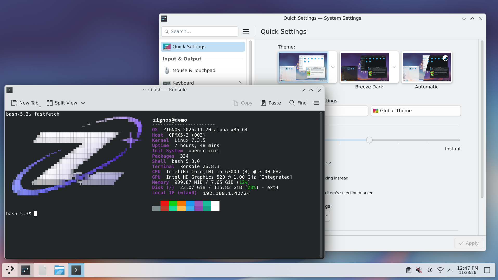

ZIGNOS has grown as a console-centric minimal base, but it now provides
**KDE Plasma 6 (Wayland)** as its first desktop environment.

**M47 actually branched the desktop series for Stable / Testing / Unstable,
M48 added SDDM on all channels and Plasma Login Manager on Testing / Unstable.
M50 added Spectacle and kio-extras, and M51 added zpkg 0.3.2 self-update and
automatic installation of new dependencies. Flatpak / xdg-desktop-portal are
supported too. `desktop/` has 252 recipes on stable and 260 on
testing / unstable; `kde-applications` has 11 apps.
Stable uses Qt 6.8.5 / KF6 6.18.0 / Plasma 6.4.6 / Gear 25.04.3, Testing uses
Qt 6.11.3 / KF6 6.32 / Plasma 6.8.3 / Gear 26.08.3, and Unstable uses
Linux 7.4-rc3 and Gear 26.11.80 beta.
stage3 and the default images remain a minimal CLI base.**



*The Testing channel (Linux 7.3.5 / Plasma 6.8.3) running on Intel HD Graphics 520.*

## Goals

- Make a Plasma 6 Wayland session work from login → panel/desktop →
  terminal/settings → logout
- Stay on OpenRC and do not move to systemd
- Keep the desktop as optional packages in `desktop/` so the CLI base does not grow
- Include Japanese display, NetworkManager, PipeWire and power management in the final form

## Channel policy

Channels have three levels: **Stable = stable/LTS, Testing = latest stable,
Unstable = more adventurous**. Changes are always validated in the order
**Unstable → Testing → Stable** and never flow backwards.

| Component | Stable (LTS/stable) | Testing (latest stable) | Unstable (adventurous) |
|---|---|---|---|
| Linux kernel | 6.18.65 LTS | 7.3.6 latest stable | 7.4-rc3 mainline |
| KDE Plasma | 6.4.6 (Qt 6.8 LTS compatible) | 6.8.3 | 6.8.3 (waiting for 6.9) |
| Qt | 6.8.5 LTS | 6.11.3 | 6.11.3 (6.12 alongside Plasma 6.9) |
| KDE Frameworks | 6.18 | 6.32 | 6.32 (6.33 alongside Plasma 6.9) |
| KDE Gear (apps) | 25.04.3 | 26.08.3 | 26.11.80 beta |
| Wayland | 1.25 | 1.26 | 1.26 |
| Mesa | 26.2.7 | 26.3.1 | 26.3.1 (main pending real GPU validation) |
| Session | elogind + Linux-PAM + polkit | Same | Same |
| Audio | PipeWire + WirePlumber | Latest stable | Latest stable |
| Login | SDDM 0.21 | SDDM 0.21 / PLM 6.8.3 | SDDM 0.21 / PLM 6.8.3 |

- **Stable** pins the Linux and Qt LTS releases and keeps Plasma / Gear on
  validated stable series. Long-term support and maintainability come first
- **Testing** adopts the latest stable (or equivalent) Linux / KDE releases
- **Unstable** is newer still and includes RC / beta / mainline / git snapshots
- New features and versions are promoted in the order Unstable → Testing → Stable
- Because Stable is an LTS branch, the latest Testing versions are not copied in
  directly; validated fixes are backported to the LTS
- `core/linux` and `desktop/` branch per channel; the rest of
  `core/` / `main/` is shared in principle

KDE Gear has no LTS like Plasma. Stable therefore pins the newest Gear that
builds with Qt 6.8 LTS (25.04.3), Testing follows the latest stable
(26.08.3), and Unstable follows the next release (26.11.80 beta).

## Package layout

The desktop itself and KDE apps are split into separate metapackages.

- **`plasma-meta`** — the Plasma session itself (kwin / plasma-workspace /
  plasma-desktop / systemsettings / plasma-nm / plasma-pa / powerdevil /
  wallpapers / kirigami-addons / polkit agent / UDisks2 and so on). KDE apps are not included
- **`kde-applications`** — KDE Gear apps. Contains Konsole / Dolphin /
  KCalc / Filelight / Kate / Ark / Gwenview / Okular / KWalletManager /
  Spectacle / kio-extras. Does not depend on Plasma itself

`plasma-meta` and `kde-applications` can be installed and removed independently.
The layout will later allow splitting into
`kde-applications-{utilities,graphics,multimedia,network,office,pim,sdk}` sub-metas.

Flatpak is added with three packages: `flatpak` / `xdg-desktop-portal` /
`xdg-desktop-portal-kde`. System helpers start via D-Bus activation, and file
selection, screen sharing and printing are handled by the KDE portal. See
[Flatpak](/en/docs/desktops/flatpak/) for details.

## Integration with OpenRC

On OpenRC, the Plasma Wayland session is supported in this order:

```
dbus → elogind → polkit → upower → display-manager
```

KWin 6 depends on the logind API and does not use seatd/libseat. **elogind is
therefore required** on OpenRC. PAM is also needed for session creation and
screen locking. In M44 **Linux-PAM moved into `core` and shadow gained PAM
support**. Console login creates the elogind seat0 session, which lets KWin
acquire DRM.

## Implementation status (M43–M51)

As of 2026-11-21, the following stack has been added to `desktop/`, with builds
and boots verified in the build VM chroot and on a BIOS/MBR validation image (QEMU).

- **Session**: Linux-PAM 1.7.3 (core) / elogind 257.16 / polkit 128.
  shadow has PAM support, and `/etc/pam.d` ships login/su/passwd etc.
- **Wayland**: wayland 1.25 / wayland-protocols 1.49 / libxkbcommon 1.13 /
  xkeyboard-config 2.45
- **Input / DRM**: libdrm 2.4.134 / libevdev / mtdev / libinput 1.32 / pixman
- **Fonts**: freetype 2.15 / harfbuzz 15.1 / fontconfig 2.18 / libpng /
  libjpeg-turbo / DejaVu
- **Graphics**: libglvnd 1.7 + Mesa 26.2.7 (virgl / softpipe / swrast,
  no LLVM). `virtio_gpu` / `kms_swrast` / `swrast` drivers come from the
  DRI megadriver (`dril`)
- **Qt / KF6 / Plasma**: Qt 6.8.5 (qtbase / qtdeclarative / qtwayland /
  qt5compat / qttools / qtpositioning / qtlocation / qtsensors),
  KF6 6.18.0, Plasma 6.4.6 (KWin / plasma-workspace / plasma-desktop /
  systemsettings / kscreenlocker / kactivitymanagerd etc.)
- **Xwayland**: Xwayland 24.1.9 / xkbcomp 1.4.7 / libXfont2 / libfontenc /
  libxshmfence. ksmserver requires xcb even on Wayland, so it is mandatory
- **QEMU validation**: boots with virtio-gpu + TCG + `noapic`; confirmed
  PAM login on tty1 → elogind session (seat0) → `startplasma-wayland` →
  KWin (DRM) → Xwayland → ksmserver → plasmashell. Panel and desktop were
  checked with a QMP screenshot (GPU is `kms_swrast` software GL)

### Added in M45

- **Audio**: ALSA 1.2.16 / libpulse 17.0 / PipeWire 1.6.7 / WirePlumber 0.5.19 /
  pulseaudio-qt 1.7.0 / plasma-pa 6.4.5. PipeWire starts
  `pipewire` + `pipewire-pulse` + WirePlumber from Plasma's XDG autostart.
  The default `pactl` sink was confirmed on QEMU's HDA
- **Network/power**: NetworkManager polkit integration, plasma-nm,
  UPower 1.91.5 + OpenRC service, powerdevil 6.4.5
- **Apps/settings**: kirigami-addons, wallpapers, polkit-kde-agent,
  Konsole / Dolphin / KCalc / Filelight 25.04.3
- **Graphics**: libglvnd X11/GLX, Mesa `glx=dri`, Xwayland `glx=true`.
  GLX 1.4 confirmed on Xwayland
- **kcm_style**: added xrdb and restored the kcminit hook
- **PAM**: added system-login / system-local-login to linux-pam;
  console/SSH login confirmed

### Added in M46

- **UDisks2**: libatasmart 0.19 / libblockdev 3.2.2 (part / fs / loop / swap /
  mdraid / crypto / nvme) / udisks2 2.10.2. For crypto and NVMe,
  cryptsetup 2.8.8 / LVM2 2.03.44 / libnvme 1.16.2 / json-c 0.19 /
  keyutils 1.6.3 / libbytesize 2.12 were added, and `plasma-meta` includes UDisks2
- **Apps**: Ark (libarchive 3.8.11), Kate, Gwenview (Exiv2 / LCMS2 /
  kImageAnnotator / kColorPicker), Okular (Qt6 frontend for Poppler 25.04.0),
  KWalletManager. `kde-applications` became 9 apps
- **Checks**: confirmed UDisks2 D-Bus activation and `udisksctl status` in the
  chroot, plus `--version` and offscreen startup for each app
- **Validation image**: booted `zignos-m46.img` (BIOS/MBR, 16 GiB sparse /
  8.8 GiB used) in QEMU; confirmed the wallpaper and panel via PAM login on
  tty1 → `startplasma-wayland` (kms_swrast). Windows for Kate / Ark /
  Gwenview / Okular / KWalletManager and `udisksctl status` (vda / sr0) also
  worked. This image is for validation and includes development tools
- **Clean validation image**: also generated `zignos-m46-clean.img`
  (BIOS/MBR, 10 GiB sparse / 6.4 GiB used), a 291-package image with
  `plasma-meta` / `kde-applications` installed from binpkgs onto a stage3 root.
  Confirmed the wallpaper, panel and clock in QEMU, plus Kate / Ark / Dolphin
  and UDisks2. Missing runtime dependencies found on the clean root (libltdl,
  Xwayland, xkbcomp, DejaVu fonts, breeze-icons, frameworkintegration and
  others) are already reflected in the recipes. `shared-mime-info 2.4` was
  also added for the MIME database, fixing Dolphin's file type/icon display.
  Japanese fonts were added as `ipaex-fonts` (IPAex Gothic / Mincho), and
  Japanese displays correctly in Kate

### Branched in M47

- **Stable**: Linux 6.18.65 LTS / Qt 6.8.5 / KF6 6.18 / Plasma 6.4.6 /
  Gear 25.04.3 / Mesa 26.2.7. Keeps the existing stable series
- **Testing**: Linux 7.3.6 / Qt 6.11.3 / KF6 6.32 / Plasma 6.8.3 /
  Gear 26.08.3 / Mesa 26.3.1. Verified in QEMU through the panel, wallpaper,
  KRunner, Dolphin, Kate and UDisks2 (vda / sr0), with 0 unresolved sonames
- **Unstable**: Linux 7.4-rc3 / Gear 26.11.80 beta. Qt 6.12, KF6 6.33 and
  Plasma 6.9 will move together with Plasma 6.9, so for now it uses the same
  Qt 6.11.3 / KF6 6.32 / Plasma 6.8.3 / Mesa 26.3.1 as Testing
- **New dependencies**: Union (libplasma style engine), libkexiv2 (wallpaper
  EXIF), libssh (Konsole), qtkeychain (plasma-nm), kholidays / knighttime,
  vulkan-headers / vulkan-loader (KWin), QCoro 0.13
- **Migration fixes**: rebuilds for the Plasma 6.8 SOVERSION change, cleanup of
  empty plasmoid directories from 6.4, `video` / `render` groups for DRM,
  setgid for `unix_chkpwd`, and `root:shadow 0640` for `/etc/shadow`
- **Unstable QEMU validation**: confirmed Linux 7.4-rc3 boots, Qt / KF6 /
  Plasma / Gear 26.11.80 build, and 0 unresolved sonames. KWin segfaults in
  QEMU's softpipe (`sp_find_cached_tile`), so the desktop was checked visually
  on Testing. Will be retested on a real GPU or when Plasma 6.9 lands

### Added in M48

- **SDDM 0.21.0-r7** — added to `plasma-meta` on all channels. Built with
  Qt 6.8.5 on Stable and Qt 6.11.3 on Testing / Unstable. The Wayland greeter
  uses `kwin_wayland --drm`; the `sddm` user (620) and `/var/lib/sddm` are
  provided by initscripts and post_install
- **Plasma Login Manager 6.8.3-r2** — added to Testing / Unstable. Instead of
  the upstream systemd user unit, it uses an OpenRC wrapper that starts
  `kwin_wayland` and `plasma-login-greeter` under `dbus-run-session`.
  Uses PAM, the `plasmalogin` user (621) and VT7
- **Shared D-Bus policy** — SDDM and PLM both owned
  `org.freedesktop.DisplayManager.conf` and conflicted, so it was moved to
  initscripts r25
- **Supplementary group fix** — patched the SDDM / PLM helpers that passed
  root's ambient groups into the session, leaking gid 0 (root) into the
  greeter and user. `video` / `render` are granted from `/etc/group`
- **Cursor** — `XCURSOR_THEME=breeze_cursors` is now the default. ZIGNOS has
  no generic `default` cursor theme, so KWin warns when it is unset
- **VT** — SDDM 0.21 dropped `MinimumVT` and uses the first free VT. If the
  `console` getty holds tty1 and causes `HELPER_TTY_ERROR`, free tty1 with
  `rc-update del console default`. PLM uses VT7

Both SDDM / PLM were verified in QEMU through daemon startup, PAM greeter
session creation and KWin DRM startup. However, with QEMU's `virtio-vga` +
`kms_swrast`, KWin segfaults in Mesa softpipe's `sp_find_cached_tile` when
compositing transparent windows (both Mesa 26.2.7 / 26.3.1). Greeter display
and login will be checked visually on a real GPU or on QEMU after the softpipe
fix. A normal Plasma user session (opaque desktop) works with the same Mesa.

### Added in M49–M51

- **M49: recipe sync** — `zpkg sync --git` compares the commit in `.zpkg-git`
  with the remote HEAD and does a shallow clone only when it changed. stage3's
  `/etc/zpkg/sync.conf` refers to GitHub's `zignos-recipes` by default
- **M50: Spectacle / kio-extras** — stable has Spectacle 6.4.6 + OpenCV
  4.14.0 (core/imgproc); Testing / Unstable have Spectacle 6.8.3 +
  KQuickImageEditor 0.7.0.1 / Tesseract 5.5.4. Ships eng / jpn /
  jpn_vert / osd tessdata for OCR. kio-extras is stable 25.04.3 /
  Testing 26.08.3 / Unstable 26.11.80 and provides workers such as
  archive / fish / info / man / thumbnail / recentlyused / search. For
  recording, FFmpeg 8.0.3 (stable) / 8.1.3 (testing/unstable) and libva 2.24.1
  were added to KPipeWire
- **M51: update system** — zpkg 0.3.2 bundles source archives in the recipe,
  so regular systems can self-update. `zpkg upgrade` installs newly required
  dependencies first, then updates existing packages. initscripts r27 added
  `git` as a dependency, needed by the default git-mode sync.conf

## Installation

Example of adding the desktop from stage3. Services are opt-in, so enable what
you need yourself.

```sh
zpkg install plasma-meta kde-applications
rc-update add networkmanager default
rc-update add upower default
# Graphical login. Enable only one of the two
rc-update add sddm default          # SDDM (all channels)
# rc-update add plasmalogin default # PLM (testing / unstable)
```

## Phases

| # | Description |
|---|---|
| M42 | Design study (done) |
| M43 | Foundation (PAM / elogind / polkit / Wayland / Mesa / fonts / Qt6) + meta-recipe skeleton (done) |
| M44 | KF6 + KWin + minimal Plasma + `plasma-meta` (done. Panel/desktop shown in QEMU) |
| M45 | Full Plasma (audio / network / power / settings / apps) + `kde-applications` (done. Verified in QEMU) |
| M46 | UDisks2 / KDE app expansion / validation images (first increment done). Distribution ISO, UEFI and real-GPU support are the next increment |
| M47 | Branching of the Stable / Testing / Unstable series (done). Testing is Qt 6.11 / Plasma 6.8 / Gear 26.08, Unstable is Linux 7.4-rc3 and Gear 26.11.80 beta. Qt 6.12 / Plasma 6.9 next |
| M48 | SDDM on all channels, PLM on Testing / Unstable (done). Fixed the helper root-group leak and shared D-Bus policy. Greeter visuals wait on a real GPU because of QEMU softpipe |
| M49 | Git-based recipe sync (done). `zpkg sync --git` and the default GitHub repository in `/etc/zpkg/sync.conf`, stage3 r20 |
| M50 | Spectacle / kio-extras on all channels (done). stable is Spectacle 6.4.6 + OpenCV, Testing / Unstable are 6.8.3 + KQuickImageEditor / Tesseract. FFmpeg / libva added for KPipeWire |
| M51 | zpkg self-update and automatic installation of new dependencies (done). zpkg 0.3.2 / initscripts r27 |

Completion criteria and dependencies for each phase are recorded in the
[roadmap](/en/docs/roadmap/).

## Validation policy

Use QEMU's virtio-gpu and Wayland to confirm a real session start including
DRM/seat.

- Add virtio-gpu, virtio-keyboard and virtio-tablet to QEMU
- Start `startplasma-wayland` from an elogind PAM session
- Check the panel/desktop/settings screens with screenshots and input events
- Check session state with `loginctl` and the KWin log

Validation on real GPUs (Intel / AMD) comes after the foundation is stable in QEMU.

## Current limitations

- `desktop/` has 212 recipes on stable / 220 on Testing / Unstable.
  `kde-applications` has 11 apps: Konsole / Dolphin / KCalc / Filelight /
  Kate / Ark / Gwenview / Okular / KWalletManager / Spectacle / kio-extras
- Spectacle is stable 6.4.6 (OpenCV core/imgproc), Testing / Unstable 6.8.3
  (KQuickImageEditor / Tesseract). Software VP8/VP9/H.264 encoders for
  recording (libvpx / openh264) are not included; use a GPU with VAAPI or add
  encoders first. Screenshot, recording and OCR GUI operations will be checked
  on a real GPU. Language data for OCR ships as eng / jpn / jpn_vert / osd
- kio-extras provides workers such as archive / fish / info / man / thumbnail /
  recentlyused / search. Samba / MTP / AFC / NFS are not included and are
  therefore disabled
- Japanese display is covered by IPAex Gothic / Mincho (UI translations remain
  English. Japanese-locale UI translation is not supported)
- SDDM 0.21 is on all channels and PLM 6.8.3 on Testing / Unstable. Both have
  KWin crashing in the greeter under QEMU's Mesa softpipe, so visual
  confirmation of the display and login waits on a real GPU
- Do not enable SDDM and PLM at the same time. If SDDM cannot take tty1, stop
  the console getty with `rc-update del console default`
- Xwayland GLX is enabled (Mesa's `libGL` / `libGLX_mesa`). Confirmation on
  real GPUs remains
- PipeWire's Bluetooth / RTKit integration is not included
- Desktop images exist only as two BIOS/MBR validation builds (one with
  development tools, one clean 291-package build from stage3). The distribution
  ISO, the UEFI version and first-time setup are the next increment

Design and implementation details are in `zignos/docs/desktop-kde.md` in the
repository.
