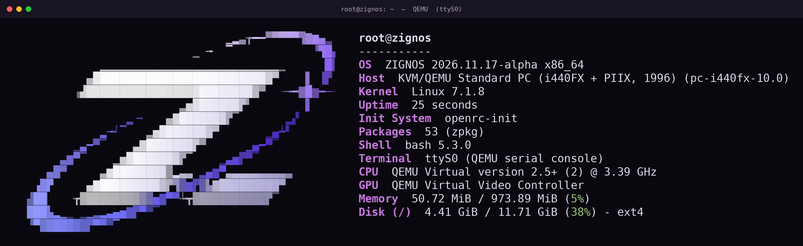

There are **two ways** to install ZIGNOS on real hardware.

1. **Official Live DVD** — boot a desktop image and use the TUI installer to copy
   the running system to an internal disk. This is the fastest route to a KDE
   Plasma desktop.
2. **stage3 tarball** — unpack the minimal base and build the kernel and GRUB
   inside a chroot. You choose the channel, disk layout and packages.

Read the comparison first, then follow the route that fits.

| | Live DVD | stage3 |
|---|---|---|
| Difficulty | Answer the installer prompts | Manual (chroot / GRUB) |
| Time | 15–30 minutes (excluding download) | 30–60 minutes or more |
| Initial state | Full testing desktop | Minimal CLI |
| Channel | testing | stable / testing / unstable |
| Network | Not needed during install | Needed for packages |
| Disk layout | GPT+ESP or MBR created automatically | Manual (LVM / LUKS possible) |
| Customization | Limited | Full |
| Best for | Trying it out / a standard desktop | Minimal systems / servers / full control |

**Live DVD advantages**

- The fastest route to a KDE Plasma desktop
- GPU drivers (Intel / AMD / NVIDIA nouveau / VMs) and Japanese input work out of the box
- No network needed during the install
- The TUI works with the keyboard alone

**Live DVD disadvantages**

- Stuck on the testing channel (it can be changed later)
- Copies every package from the Live system, using about 10 GB
- Less control over partitions and package selection
- Alpha build: things may change or break

**stage3 advantages**

- Start from a minimal base and add only what you need
- Choose the channel and the disk layout, including LUKS / LVM
- You can follow the build and dependency chain

**stage3 disadvantages**

- Partitioning, chroot, kernel and GRUB are manual
- Needs a network to fetch packages
- The desktop is a separate install

> **Caution**: `<DISK>` is a **whole disk** such as `/dev/nvme0n1` or
> `/dev/sda`, and `<PART>` is a partition such as `nvme0n1p1` or `sda1`.
> Running the commands destroys all data on the target disk. Always confirm
> with `lsblk`.

## Install from the Live DVD

The official Live DVD is a bootable image with the KDE Plasma 6 desktop.
The TUI installer in the Live session copies the running system to an internal
disk. The installed system is the same testing-channel desktop as the Live
session.

### What you need

- A USB drive of 8 GB or more
- 2 GiB of memory (4 GiB recommended)
- The Live DVD ISO from the [download page](/en/download/#live) (about 4.4 GB)
- No network during the install

### Download and verify

Get the ISO and SHA-256 from the [download page](/en/download/#live).

```sh
sha256sum zignos-live-desktop-20261125.iso
# cdefa3d135bd9be56d3388a18f6ee1da0c9e642b2c54f9bf63702bd79049f755
```

### Write it to USB

> **Note (2026.11.25 alpha)**: this ISO is currently **CD/DVD only**. It has no
> MBR/GPT, so writing it to a USB drive with `dd` will not boot on BIOS or UEFI.
> To try it from USB, use an ISO bootloader such as Ventoy, or boot it from a
> CD/DVD or a VM's CD-ROM. A hybrid ISO (direct USB write) is in preparation.

### Boot

- UEFI: disable Secure Boot and put the USB drive first in the boot order
- BIOS: boot from the USB drive
- Choose "ZIGNOS Live" in the GRUB menu
- The Live desktop starts with automatic login (user `live`, no password)

### Start the installer

Use the "Install ZIGNOS" icon on the desktop, or run:

```sh
doas zignos-installer
```

1. Choose the target disk (all data on it is destroyed)
2. Choose the firmware (UEFI / BIOS)
3. Enter the hostname, user name, password, timezone, locale and keymap
4. Review the summary and start
5. The progress gauge advances; wait for "Installation complete."
6. Reboot and remove the USB drive

SDDM appears after the reboot. Log in as the user you created.

### Initial state after install

- root is locked; use `doas` (the new user is in wheel)
- KDE Plasma 6 (Wayland), KDE applications, NetworkManager, PipeWire,
  fcitx5 + Mozc, Flatpak and the GPU drivers are installed
- The channel is testing; change it with `zpkg channel`
- Because the Live system is copied as-is, it uses about 10 GB

### Notes

- This is an alpha build. Report problems in the
  [forum](/en/docs/community/forum/) or Issues
- The whole disk is erased; confirm the target with `lsblk`
- Secure Boot must be disabled (GRUB and the kernel are unsigned)
- No root password is set. Set one with `doas passwd root` if you need it

## Install from stage3 (sections 1–10)

The rest of this page is the stage3 route: unpack the minimal base and install
the kernel and GRUB inside a chroot. You choose the channel, disk layout and
additional packages.

## Requirements

| Item | Requirement / guideline |
|---|---|
| CPU | x86_64 |
| Firmware | BIOS or UEFI (Secure Boot disabled) |
| Memory | 512 MiB or more for CLI; 2 GiB or more recommended for KDE Plasma |
| Storage | 8 GiB or more for CLI; 16 GiB or more recommended for a desktop |
| Network | Wired recommended. WiFi requires firmware |
| Installation media | USB flash drive with SystemRescue written to it (currently 13.03) |
| stage3 | The tarball and SHA-256 from the [download page](/en/download/) |

stage3 is about 1.1 GiB. Space for the kernel, GRUB, additional packages and
the build cache is required separately.

## Supported firmware

| Firmware | Disk | GRUB | Notes |
|---|---|---|---|
| **UEFI** (default) | GPT + ESP (FAT32) + ext4 root | `x86_64-efi` + efibootmgr | Secure Boot must be disabled |
| BIOS/CSM | MBR + ext4 root | `i386-pc` | Disks larger than 2 TiB are not supported |

---

## 1. Prepare SystemRescue

Work on real hardware is done from **SystemRescue**. It boots on both BIOS and
UEFI and provides `sfdisk`, `mkfs`, `tar`, `chroot` and `efibootmgr`.

- Official site: <https://www.system-rescue.org/>
- Latest as of 2026-11-17: **SystemRescue 13.03**
- A USB flash drive of 2 GiB or more

### Write to USB

```sh
# Download and verify (example)
curl -LO https://fastly-cdn.system-rescue.org/releases/13.03/systemrescue-13.03-amd64.iso
curl -LO https://fastly-cdn.system-rescue.org/releases/13.03/systemrescue-13.03-amd64.iso.sha256
sha256sum --check systemrescue-13.03-amd64.iso.sha256

# Write to USB (/dev/sdX is the whole USB device. A mistake destroys a disk)
sudo dd if=systemrescue-13.03-amd64.iso of=/dev/sdX bs=4M status=progress conv=fsync
sync
```

### Boot

1. Insert the USB drive and open the firmware boot menu
2. On **UEFI machines, boot in UEFI mode** (CSM disabled); on BIOS machines,
   boot in legacy mode
3. **Disable Secure Boot** (the ZIGNOS GRUB and kernel are unsigned)
4. After booting, wired LAN uses DHCP automatically. Configure WiFi with `nmtui`

---

## 2. Prepare the disk

> **`cfdisk` is recommended for beginners.** It creates and deletes partitions
> interactively while showing them, so there is no risk of mistyping an
> `sfdisk` script. The `sfdisk` one-shot layout for experienced users is still
> in 2.4.

First identify the target disk. **The operations below destroy all data on the
disk.**

```sh
lsblk -o NAME,SIZE,MODEL,TYPE
```

`<DISK>` is a **whole disk** such as `/dev/nvme0n1` or `/dev/sda`. Partition
names are `<DISK>p1` on NVMe and `<DISK>1` on SATA.

### 2.1 Example layout

#### UEFI + GPT

| Mount point | Partition | Partition type | Size |
|---|---|---|---|
| `/mnt/zignos/boot/efi` | `<DISK>p1` | EFI system partition (FAT32) | **512 MiB** (300 MiB minimum; 1 GiB with multiple kernels) |
| `[swap]` (optional) | `<DISK>p2` | Linux swap | 512 MiB or more |
| `/mnt/zignos` | `<DISK>p3` | Linux x86-64 root (/) | All remaining space |

#### BIOS + MBR

| Mount point | Partition | Partition type | Size |
|---|---|---|---|
| `[swap]` (optional) | `<DISK>1` | Linux swap | 512 MiB or more |
| `/mnt/zignos` | `<DISK>2` | Linux | All remaining space |

- **Swap is not required.** Create it if you use hibernation or have little
  memory. It can also be added later as a swap file
- Without swap, root is `<DISK>p2` on UEFI and `<DISK>1` on BIOS; shift the
  numbers in the examples below forward by one
- **512 MiB** is recommended for the ESP. ZIGNOS places copies named
  `/boot/vmlinuz-<ver>` and `initramfs-<ver>.img` there, so use 1 GiB if you
  keep multiple kernels
- BIOS/MBR cannot handle **disks larger than 2 TiB**. Use UEFI/GPT if possible
- Secure Boot must be disabled (the ZIGNOS GRUB and kernel are unsigned)

### 2.2 Create with cfdisk (recommended)

```sh
cfdisk <DISK>
```

1. Choose **`gpt`** for UEFI or **`dos`** for BIOS
2. `[New]` → `512M` → set the type to **`EFI System`** on UEFI
3. To create swap, `[New]` → `512M` → set the type to **`Linux swap`**
4. `[New]` → all remaining space → set the type to **`Linux filesystem`**
   (`Linux` on BIOS)
   On BIOS, also select the root partition and mark it **`[Bootable]`**
5. `[Write]` → `yes` to write, then `[Quit]` to exit
6. Make the kernel reread the partition table

```sh
partx -u <DISK>
# If the change does not appear
partprobe <DISK>
```

> `cfdisk` shows the existing partition table as soon as it starts. On a disk
> that still holds another OS or data, **always compare `lsblk` with what is
> displayed before writing**. If an existing signature remains and `mkfs`
> refuses, erase it with `wipefs -a <DISK>` (this destroys all data).

### 2.3 Format and mount

#### UEFI + GPT

Without swap (minimal layout):

```sh
mkfs.vfat -F32 -n ZIGNOSESP <DISK>p1
mkfs.ext4 -L zignos-root <DISK>p2

mkdir -p /mnt/zignos/boot/efi
mount <DISK>p2 /mnt/zignos
mount <DISK>p1 /mnt/zignos/boot/efi
```

With swap (root is p3):

```sh
mkfs.vfat -F32 -n ZIGNOSESP <DISK>p1
mkswap <DISK>p2
swapon <DISK>p2
mkfs.ext4 -L zignos-root <DISK>p3

mkdir -p /mnt/zignos/boot/efi
mount <DISK>p3 /mnt/zignos
mount <DISK>p1 /mnt/zignos/boot/efi
```

#### BIOS + MBR

Without swap (minimal layout):

```sh
mkfs.ext4 -L zignos-root <DISK>1
mount <DISK>1 /mnt/zignos
```

With swap (root is 2):

```sh
mkswap <DISK>1
swapon <DISK>1
mkfs.ext4 -L zignos-root <DISK>2
mount <DISK>2 /mnt/zignos
```

To keep swap in `/etc/fstab`, check the UUID with `blkid` and add the following
line.

```
UUID=<swap UUID> none swap sw 0 0
```

### 2.4 Create everything with sfdisk (advanced)

This example creates the minimal layout without swap in one operation. If you
need swap, add it with `cfdisk` or add another line to the `sfdisk` input.

#### UEFI + GPT

```sh
sfdisk <DISK> <<'EOF'
label: gpt
start=2048, size=1048576, type=C12A7328-F81F-11D2-BA4B-00A0C93EC93B, name="ZIGNOS ESP"
start=1050624, type=0FC63DAF-8483-4772-8E79-3D69D8477DE4, name="zignos-root"
EOF
partx -u <DISK>

mkfs.vfat -F32 -n ZIGNOSESP <DISK>p1
mkfs.ext4 -L zignos-root <DISK>p2

mkdir -p /mnt/zignos/boot/efi
mount <DISK>p2 /mnt/zignos
mount <DISK>p1 /mnt/zignos/boot/efi
```

#### BIOS + MBR

```sh
sfdisk <DISK> <<'EOF'
label: dos
start=2048, type=83, bootable
EOF
partx -u <DISK>

mkfs.ext4 -L zignos-root <DISK>1
mount <DISK>1 /mnt/zignos
```

---

## 3. Prepare the stage3 tarball

stage3 is a minimal base without the kernel and GRUB. The current manifest is
**{{release}} / stage3 {{stage3.revision}} ({{stage3.package_count}} packages /
about {{stage3.size_mib}} MiB)**. r21 includes Linux headers 6.18.65,
OpenSSL 4.0.3, zpkg 0.3.4-r4, locales (en_US.UTF-8 / ja_JP.UTF-8) and
Go 1.27.4. The release is available from the [download page](/en/download/)
and GitHub Releases.

For developers, it is generated in a build VM.

```sh
# In the working tree on the build host
sudo OUT=/var/tmp/zignos-stage3-20261124-r21-x86_64.tar.xz ./make-stage3.sh
sha256sum /var/tmp/zignos-stage3-20261124-r21-x86_64.tar.xz \
  > /var/tmp/zignos-stage3-20261124-r21-x86_64.tar.xz.sha256
```

Carry the result to the target machine over USB or SSH and **verify the
checksum before unpacking**.

```sh
sha256sum --check zignos-stage3-20261124-r21-x86_64.tar.xz.sha256
```

> **Current manifest (r21)**: as of {{build_date}}, **{{stage3.package_count}}
> packages / about {{stage3.size_mib}} MiB**. The file name is
> `{{stage3.filename}}` and the SHA-256 is `{{stage3.sha256}}`.
>
> r21 bundles Linux headers 6.18.65, OpenSSL 4.0.3, zpkg 0.3.4-r4, locales and
> Go 1.27.4. After booting, add and update channels with
> `zpkg sync && zpkg upgrade`.
>
> root is locked, and no SSH host keys, machine-id or users are included.

---

## 4. Unpack stage3

```sh
tar -xpf zignos-stage3.tar.xz -C /mnt/zignos
```

`/etc/resolv.conf` contains the build environment's version, so overwrite it
to match the target machine's network (the SystemRescue 127.0.0.53 stub does
not work in a chroot).

```sh
printf 'nameserver 1.1.1.1\nnameserver 8.8.8.8\n' > /mnt/zignos/etc/resolv.conf
```

---

## 5. Enter the chroot

stage3 does not include `zignos-enter.sh`. Mounting manually and entering is
the reliable way. **On UEFI, rbind `/sys` so efivarfs is visible inside the
chroot** (efibootmgr reads and writes NVRAM).

```sh
mkdir -p /mnt/zignos/{dev,proc,sys,run}
mount --rbind /dev /mnt/zignos/dev
mount --make-rslave /mnt/zignos/dev
mount -t proc proc /mnt/zignos/proc
mount --rbind /sys /mnt/zignos/sys
mount --make-rslave /mnt/zignos/sys
mount --rbind /run /mnt/zignos/run
mount --make-rslave /mnt/zignos/run

chroot /mnt/zignos /bin/bash -l
```

If you use `zignos-enter.sh`, add the `/sys` rbind manually on UEFI only (the
helper mounts a fresh sysfs, which can hide efivarfs).

> When isolating builds with bubblewrap, a plain `chroot` cannot use
> `pivot_root`; `auto` warns and falls back to building directly.
> `zignos-enter.sh` bind-mounts the root inside a private mount namespace
> before chrooting, so the sandbox works even with a directory chroot on
> stage3.

Once inside the chroot, set the root password first (it is locked in stage3).

```sh
passwd
```

---

## 6. Initial base configuration

stage3 has no editor, DHCP, SSH or man. Configuration files can be created with
a `cat` heredoc (install `vim nano` later if needed).

### Hostname

```sh
echo zignos > /etc/hostname
```

### Time zone

`tzdata` is included. The default is UTC.

```sh
ln -sf /usr/share/zoneinfo/Asia/Tokyo /etc/localtime
date
```

### Keyboard (if needed)

```sh
loadkeys jp106
cat > /etc/conf.d/keymaps <<'EOF'
keymap="jp106"
EOF
rc-update add keymaps boot
```

### fstab

stage3 includes `/usr/sbin/zignos-fstab`. Run it from the rescue environment
with the target root mounted at `/mnt/zignos`, and it generates the `/` and
(if mounted) `/boot/efi` lines from the actual mount information.

```sh
/mnt/zignos/usr/sbin/zignos-fstab /mnt/zignos
```

To write it by hand, check the UUIDs with `blkid`. On UEFI, registering the ESP
in fstab as well lets `grub-install` and kernel updates use `/boot/efi`.

```sh
blkid <ROOT-PART>  # UUID of root (example: UEFI with swap = <DISK>p3)
blkid <DISK>p1     # UUID of the ESP (UEFI only)

cat > /etc/fstab <<EOF
UUID=<ROOT-UUID> / ext4 defaults 0 0
UUID=<ESP-UUID> /boot/efi vfat defaults 0 0
proc  /proc proc  defaults 0 0
sysfs /sys  sysfs defaults 0 0
EOF
```

**Important**: if the UUID or device on the `/` line does not match reality,
`/` stays **read-only** at boot. The OpenRC `root` service uses fstab to
remount, so a wrong UUID makes the remount fail (the service still reports
`started`). If you wrote the file by hand, always compare
`findmnt -no SOURCE /mnt/zignos` with `blkid`.

On BIOS, remove the ESP line. If you do not want `/boot/efi` mounted all the
time, you may comment out the ESP line instead (mount it only when installing
GRUB).

---

## 7. Install the kernel

```sh
zpkg install linux
```

- It is built with `x86_64-generic.config` and installs `/boot/vmlinuz`,
  `/boot/initramfs.img` and `/usr/lib/modules/6.18.65`
- The first run downloads the source and builds it, which takes **from a few
  minutes to a dozen or so minutes**
- To change the configuration, edit
  `/usr/share/zignos/recipes/stable/core/linux/x86_64-generic.config` and
  rebuild with `zpkg install -f linux`

```sh
ls -l /boot/vmlinuz /boot/initramfs.img
ls /usr/lib/modules
```

---

## 8. Install GRUB

### UEFI (default; uses efibootmgr)

Enabling GRUB's `uefi` USE flag **automatically installs efibootmgr and efivar
as dependencies**. This is simpler than the previous approach of only placing
a binary on the fallback path.

```sh
# Build for UEFI (efibootmgr/efivar are installed as dependencies too)
zpkg use --package grub uefi
zpkg install linux grub

# Check the x86_64-efi modules and efibootmgr
ls /usr/lib/grub/x86_64-efi
command -v efibootmgr
```

> If GRUB is already installed, change the USE flag and rebuild with
> `zpkg upgrade grub` or `zpkg install -f grub`.

Create `/etc/default/grub` (this example also enables the serial console).

```sh
cat > /etc/default/grub <<'EOF'
GRUB_DISTRIBUTOR="ZIGNOS"
GRUB_TIMEOUT=5
GRUB_DEFAULT=0
GRUB_CMDLINE_LINUX_DEFAULT="console=tty0 console=ttyS0"
GRUB_CMDLINE_LINUX=""
GRUB_TERMINAL="console serial"
GRUB_SERIAL_COMMAND="serial --unit=0 --speed=115200"
EOF
```

Confirm that the ESP is mounted at `/boot/efi`, then install GRUB.

```sh
mountpoint /boot/efi || mount <DISK>p1 /boot/efi

/usr/sbin/grub-install \
  --target=x86_64-efi \
  --efi-directory=/boot/efi \
  --bootloader-id=ZIGNOS \
  --recheck

/usr/sbin/grub-mkconfig -o /boot/grub/grub.cfg
```

> Confirm that `grub-mkconfig` prints
> `Found linux image: /boot/vmlinuz-6.18.65`. If it does not, see
> "ZIGNOS does not appear in the GRUB menu".

If efibootmgr is usable, `grub-install` **creates the NVRAM entry
automatically**. Verify it.

```sh
efibootmgr -v
```

You are done if `Boot####` contains `ZIGNOS` pointing at
`\EFI\ZIGNOS\grubx64.efi`. If it is not first in `BootOrder`, check the
`Boot####` number and set it.

```sh
# Example: ZIGNOS is Boot0003
efibootmgr --bootorder 0003,0000
```

If it was not registered automatically (or you installed with `--no-nvram`),
add it manually.

```sh
efibootmgr --create \
  --disk <DISK> --part 1 \
  --label ZIGNOS \
  --loader '\EFI\ZIGNOS\grubx64.efi'

efibootmgr -v
```

- `--part 1` is the **partition number of the ESP** (`1` even on NVMe)
- `--loader` uses backslashes (single-quote it in the shell)
- If `efibootmgr` says "EFI variables are not supported", you are not booted
  in UEFI mode or efivarfs is not visible in the chroot. Reboot SystemRescue
  in UEFI mode, rbind `/sys`, and try again

To also place a fallback (`/EFI/BOOT/BOOTX64.EFI`), you can build a standalone
version for when NVRAM is lost (not required).

```sh
/usr/bin/grub-mkstandalone -O x86_64-efi \
  -o /boot/efi/EFI/BOOT/BOOTX64.EFI \
  --modules="part_gpt part_msdos fat ext2 normal search search_fs_uuid linux echo serial terminal" \
  "boot/grub/grub.cfg=/boot/grub/grub.cfg"
```

### BIOS (MBR)

```sh
zpkg use --package grub bios
zpkg install linux grub

cat > /etc/default/grub <<'EOF'
GRUB_DISTRIBUTOR="ZIGNOS"
GRUB_TIMEOUT=5
GRUB_CMDLINE_LINUX_DEFAULT="console=tty0 console=ttyS0"
GRUB_TERMINAL="console serial"
GRUB_SERIAL_COMMAND="serial --unit=0 --speed=115200"
EOF

/usr/sbin/grub-install --target=i386-pc --boot-directory=/boot <DISK>
/usr/sbin/grub-mkconfig -o /boot/grub/grub.cfg
```

---

## 9. Finishing before the first boot

### Regular user

```sh
useradd -m -G wheel -s /bin/bash yourname
passwd yourname
```

The `wheel` group is provided by initscripts. In the base system, the only
privilege escalation tool is `su`. To use `doas`:

```sh
zpkg install doas
```

### SSH (optional)

```sh
zpkg install openssh
rc-update add sshd default
install -d -m700 -o yourname -g yourname /home/yourname/.ssh
# Place /home/yourname/.ssh/authorized_keys with mode 600
```

`sshd` starts with root login disabled. Root on the console remains for
recovery.

### Network (optional)

stage3 includes neither a DHCP client nor NetworkManager. Choose **either A or
B** below.

#### A. dhcpcd + wpa_supplicant (minimal)

Wired:

```sh
zpkg install dhcpcd
rc-update add dhcpcd boot
```

WiFi requires firmware and a supplicant.

```sh
zpkg install wpa_supplicant iw linux-firmware
rc-update add wpa_supplicant default
# Change WPA_IFACE (default wlan0) in /etc/conf.d/wpa_supplicant if needed
```

`linux-firmware` is about 2 GiB. It is also possible to install only the
firmware you need.

#### B. NetworkManager (nmcli / nmtui)

This option manages wired and WiFi connections together. NetworkManager is a
`main` package, so it is not included in stage3.

```sh
zpkg install networkmanager-wifi
rc-update add networkmanager default
```

`networkmanager-wifi` is a meta package that installs **NetworkManager +
wpa_supplicant + iw + linux-firmware** together. To avoid the mistake of
forgetting the firmware and having WiFi go unrecognized, use this when you
need WiFi. For wired only, `zpkg install networkmanager` alone is fine.

> `networkmanager-wifi` is included in **stage3 r13 and later** (the current
> build is r21). On r12, use
> `zpkg install networkmanager wpa_supplicant iw linux-firmware`.
>
> On **machines with WiFi only**, installing the WiFi stack inside this chroot
> before rebooting is the reliable approach. The chroot can use SystemRescue's
> network as is, so you can fetch linux-firmware here (about 1 GiB download /
> about 2 GiB installed).

`nmtui` and `nmcli` are installed. To connect with the TUI first:

```sh
nmtui
```

To operate from the CLI:

```sh
nmcli general status
nmcli device status
nmcli device wifi list
nmcli device wifi connect "<SSID>" password "<PASSWORD>"
```

NetworkManager uses its internal DHCP and wpa_supplicant integration, so **do
not enable the dhcpcd and wpa_supplicant services** (avoid combining A and B).

If WiFi is not visible, first check the device and firmware.

```sh
ip link                     # Is wlan0 / wlp* present?
iw dev
rfkill list                 # Soft blocked / Hard blocked
dmesg | grep -i -E 'iwlwifi|firmware'
```

If `Direct firmware load ... failed` appears, `linux-firmware` is not installed
(it is installed by `zpkg install networkmanager-wifi`). Intel Wireless-AC
8260 (`8086:24f3`) works with `iwlwifi` + `iwlwifi-8000C-36.ucode`.

### Leave the chroot and reboot

```sh
exit

umount -R /mnt/zignos/dev
umount -R /mnt/zignos/sys
umount -R /mnt/zignos/run
umount /mnt/zignos/proc
umount /mnt/zignos/boot/efi 2>/dev/null || true
umount /mnt/zignos
sync
reboot
```

Select **ZIGNOS** in the firmware boot menu. If NVRAM registration did not
work on UEFI, remove the USB drive, reboot, and choose
`\EFI\ZIGNOS\grubx64.efi` or `\EFI\BOOT\BOOTX64.EFI` from the firmware's
one-time boot menu.

---

## 10. Desktop and VIDEO_CARDS (optional)

To install KDE Plasma 6, **choose the GPU driver before building Mesa**.
ZIGNOS's Mesa switches Gallium drivers via `VIDEO_CARDS`, so installing
`plasma-meta` without setting it builds with the QEMU default
(`virgl softpipe`).

### 10.1 GPU and VIDEO_CARDS

| GPU | Value to set | Example command |
|---|---|---|
| Intel Gen8 and later (Skylake / Kaby Lake / Coffee Lake / Ice Lake and later) | `iris` | `zpkg video-cards iris` |
| Intel Gen4-7 (Haswell / Broadwell) | `crocus` | `zpkg video-cards crocus` |
| Intel Gen3 (Ivy Bridge and earlier) | `i915` | `zpkg video-cards i915` |
| AMD GCN and later (Sea Islands / Polaris / Vega / RDNA) | `radeonsi` (`amdgpu` also works) | `zpkg video-cards radeonsi` |
| AMD R600 / R7000 | `r600` | `zpkg video-cards r600` |
| NVIDIA (nouveau) | `nouveau` (`nvidia` also works) | `zpkg video-cards nouveau` |
| QEMU / KVM (virtio-gpu) | `virgl` | `zpkg video-cards virgl` |
| Software rendering | `softpipe` / `llvmpipe` | `zpkg video-cards softpipe` |

- `iris` on Intel Gen8 and later and `crocus` on Gen4-7 automatically install
  `llvm`, `spirv-headers`, `spirv-tools` and `spirv-llvm-translator` as
  makedepends for Mesa's CLC. The first run takes time to download and build
- `radeonsi`, `r600`, `llvmpipe` and `nouveau` use LLVM
- The proprietary NVIDIA driver is not included in ZIGNOS recipes. Choose
  `nouveau` only when using Mesa's Gallium driver
- For multiple GPUs, separate the values with spaces, as in
  `VIDEO_CARDS="iris virgl"`

### 10.2 Configure

`zpkg video-cards` writes to `/etc/zpkg/make.conf`.

```sh
# Intel hardware
zpkg video-cards iris

# AMD
zpkg video-cards radeonsi

# QEMU
zpkg video-cards virgl

# Show the current setting
zpkg video-cards
```

To write it directly, add one line to `/etc/zpkg/make.conf`.

```sh
VIDEO_CARDS="iris"
```

### 10.3 Install the desktop

```sh
zpkg install plasma-meta kde-applications
rc-update add dbus default
rc-update add elogind default
rc-update add polkit default
rc-update add upower default
# Only if using NetworkManager
rc-update add networkmanager default
rc-update add sddm default
```

To use Plasma Login Manager, run `rc-update add plasmalogin default` instead of
`sddm` (Testing / Unstable). Do not enable SDDM and PLM at the same time. If
the console getty holds tty1 and the login screen does not appear, free tty1
with `rc-update del console default`.

See [KDE Plasma 6](/en/docs/system/desktop/) for the desktop layout and
services.

### 10.4 Change VIDEO_CARDS later

Mesa must be rebuilt.

```sh
zpkg video-cards iris
zpkg install -f mesa
```

Or, to have `zpkg upgrade` pick up the configuration change:

```sh
zpkg upgrade --newuse
```

Only recipes that have a `video_cards` file are affected by `VIDEO_CARDS`. The
selected value is also part of Mesa's binpkg key.

---

## 11. After the first boot

```sh
uname -r                 # 6.18.65
rc-status                # udev / console / console-vga are started
ip addr                  # If wired DHCP was installed
```

- The root password was set during installation
- Install networking, SSH, an editor and man as needed with `zpkg install`
- Time synchronization: `zpkg install chrony && rc-update add chronyd default`
- System update: `zpkg upgrade` (shows the change list, dependency differences
  and warnings before running)
- Check the channel: `zpkg channel`. For testing / unstable, fetch the recipe
  tree with `zpkg sync`, then switch with `zpkg channel testing`

### Advanced A: copy from an existing ZIGNOS with `zignos-install`

Copy a running ZIGNOS to another disk. The Live DVD's TUI installer uses the
same `zignos-install` engine internally; for normal installs follow the
"Install from the Live DVD" steps above.

```sh
# On the running ZIGNOS
lsblk
zignos-install /dev/nvme0n1
```

Booting in UEFI gives GPT + ESP; BIOS gives MBR. If `efibootmgr` is present,
the NVRAM entry is registered too.

### Alternative B: Write the image directly with `dd`

```sh
dd if=zignos-uefi.img of=/dev/nvme0n1 bs=4M status=progress conv=fsync
sync

# Expand the root partition to the whole disk (2 on UEFI, 1 on BIOS)
parted /dev/nvme0n1 resizepart 2 100%
partprobe /dev/nvme0n1
e2fsck -f /dev/nvme0n1p2
resize2fs /dev/nvme0n1p2
```

After booting, log in as root and create a user (see the image's instructions
for the initial password).

### Alternative C: Rescue and maintenance

```sh
mount <ROOT-PART> /mnt/zignos          # Example: /dev/nvme0n1p3
mount <ESP-PART> /mnt/zignos/boot/efi  # UEFI (example: /dev/nvme0n1p1)

# Check the configuration
cat /mnt/zignos/etc/fstab
cat /mnt/zignos/boot/grub/grub.cfg

# chroot and operate zpkg
mount --rbind /dev /mnt/zignos/dev
mount -t proc proc /mnt/zignos/proc
mount --rbind /sys /mnt/zignos/sys
chroot /mnt/zignos /bin/bash
```

`/etc/fstab` and GRUB's `root=` use **filesystem UUIDs**. If you copied the
disk, check them with `blkid` and rewrite them.

---

## Network and WiFi notes

- Wired: install `dhcpcd` and run `rc-update add dhcpcd boot`
- With NetworkManager, run `zpkg install networkmanager-wifi` →
  `rc-update add networkmanager default`. Configure with `nmcli` / `nmtui`
  (do not enable the dhcpcd / wpa_supplicant services). For wired only,
  `zpkg install networkmanager`
- WiFi: `networkmanager-wifi` installs `wpa_supplicant` + `iw` +
  `linux-firmware` together. In a standalone setup, use `wpa_supplicant` +
  `iw` + `linux-firmware`. Match `WPA_IFACE` (default `wlan0`) in
  `/etc/conf.d/wpa_supplicant` to your environment
- WiFi drivers are kernel modules. Both at boot and on hotplug, **eudev +
  kmod** load them automatically via uevents
- If it does not load, identify the chip with `lspci -k` / `lsusb` and run
  `modprobe <driver>`
- If `iw dev` shows no interface, check `dmesg | grep -i firmware`

## Kernel configuration and customization

- The default is `x86_64_defconfig` + `core/linux/x86_64-generic.config`
- Boot-critical pieces (ACPI/APIC, SATA AHCI, NVMe, USB/XHCI,
  VT/VGA/simpledrm, ext4/vfat, virtio, main NICs) are built in; GPU, WiFi and
  additional NICs are modules
- To change it, edit the recipe's configuration file and run
  `zpkg install -f linux`
- Kernel updates regenerate the initramfs at the same time

## Troubleshooting

### `Read-only file system` after boot

The `/` line in `/etc/fstab` does not match the actual root. Run the following
as root on the console.

```sh
mount -o remount,rw "$(findmnt -no SOURCE /)" /
zignos-fstab /
```

`zignos-fstab` rewrites `/etc/fstab` from the actual mount information
(initscripts r18 and later; older stage3 does not have it, so check
`findmnt -no SOURCE /` and `blkid` and fix the `UUID=... / ...` line by hand).
After fixing, verify with `rc-service root restart` or a reboot.

Cause: the OpenRC `root` service runs `mount -o remount,rw /`, which refers to
the `/` line in fstab, so a wrong UUID or device makes the remount fail. Note
that the service still reports `started`, which makes this easy to miss.

### `grub-install` cannot read EFI variables

- Check that SystemRescue is booted in **UEFI mode**
- Check that `/sys` is rbind-mounted into the chroot
  (`mount --rbind /sys /mnt/zignos/sys`)
- Check whether `efibootmgr -v` works. If it does not, NVRAM registration is
  impossible, so boot via the fallback `\EFI\BOOT\BOOTX64.EFI` or rerun in a
  UEFI environment

### ZIGNOS does not appear in NVRAM

```sh
efibootmgr -v
efibootmgr --create --disk <DISK> --part 1 --label ZIGNOS \
  --loader '\EFI\ZIGNOS\grubx64.efi'
efibootmgr --bootorder <ZIGNOS boot number>,<others>
```

### Cannot log in as root on stage3

The stage3 root is locked. Enter the chroot and set a password with `passwd`.

### No editor / network / SSH

stage3 is a minimal base. Add them with
`zpkg install vim nano dhcpcd openssh`, for example. Using the network inside
the chroot requires `/etc/resolv.conf` and NIC configuration.

### A recipe for a new package is not found (`recipe not found`)

The `/usr/share/zignos/recipes` bundled with stage3 is a snapshot from when
that stage3 was built. `zpkg sync` replaces it with a new recipe tree. By
default, stage3's `/etc/zpkg/sync.conf` references `zignos-recipes` on GitHub
in git mode (`RECIPEGIT=1`), compares the commit in `.zpkg-git` with the
remote HEAD, and shallow-clones only when there is a change.

```sh
# Sync from the default git repository
zpkg sync

# To specify explicitly
zpkg sync --git --from https://github.com/studio-nosa-tech/zignos-recipes

# A new stage3 tarball, recipe tarball, directory or URL also works
zpkg sync --from zignos-stage3-<new>.tar.xz
zpkg sync --from zignos-recipes-20261123-r21.tar.xz
zpkg sync --from ./zignos-recipes
zpkg sync --from https://example.invalid/zignos-recipes.tar.xz

# Verify only
zpkg sync --git -n

# Verify
zpkg search networkmanager
```

`sync` validates the new tree in a temporary area and then replaces it
atomically, so the old tree remains if it fails. If `--from` is omitted,
`RECIPEURL=` (and `RECIPEGIT` / `RECIPEBRANCH`) in `/etc/zpkg/sync.conf` are
used. The `ZPKG_RECIPE_URL` environment variable also overrides it.

The distributed recipe tarball contains **all three channels: stable / testing
/ unstable**. If you do not use git, sync this tarball and then switch.

```sh
zpkg sync --from zignos-recipes-20261123-r21.tar.xz --allow-unsigned
zpkg channel testing      # Updates CHANNEL= in /etc/zpkg/make.conf
zpkg upgrade -p           # Review the change list
zpkg upgrade              # Run (with a confirmation prompt)
```

See [Release channels](/en/docs/channels/) for details.

Newer zpkg verifies the recipe tree's `recipes.manifest` with a trusted key.
Unsigned trees are rejected by default, so **for the current unsigned
release** add `--allow-unsigned` explicitly (this becomes unnecessary once the
official signing key is in use).

```sh
zpkg sync --from zignos-recipes-20261123-r21.tar.xz --allow-unsigned
```

To verify a signed tree, import the public key first.

```sh
zpkg key import zignos-signing.pub
zpkg sync --from zignos-recipes-20261123-r21.tar.xz
```

See [Package signing and verification](/en/docs/signing/) for details.

> If the zpkg in an older stage3 has no `sync`, extract only `usr/bin/zpkg`
> from a new stage3 tarball and run it.
>
> ```sh
> tar -xJf zignos-stage3-<new>.tar.xz -C /tmp/zpkg-new ./usr/bin/zpkg
> /tmp/zpkg-new/usr/bin/zpkg sync --from zignos-stage3-<new>.tar.xz
> ```

### `zpkg install linux` is slow or fails

The first run downloads and builds the kernel source. Check the network and
free space (several GiB). If a binpkg repository is configured, it is used
instead.

### `certs/extract-cert.c: openssl/bio.h: No such file or directory`

Older stage3 did not include openssl in linux's build dependencies. Kernel
6.18.65 requires OpenSSL headers to build `certs/extract-cert`.

```sh
zpkg install openssl
zpkg install linux
```

The latest stage3 / recipes already add openssl to linux's `makedepends`
(perl is also installed automatically to build openssl).

### ZIGNOS does not appear in the GRUB menu (UEFI firmware settings only)

Older linux packages install the kernel under the **versionless names**
`/boot/vmlinuz` and `/boot/initramfs.img`, so `grub-mkconfig`'s `10_linux`
cannot find the kernel. Create copies with the version in the name, then
regenerate.

```sh
KVER=$(ls /usr/lib/modules | tail -1)
cp -f /boot/vmlinuz /boot/vmlinuz-$KVER
cp -f /boot/initramfs.img /boot/initramfs-$KVER.img
grub-mkconfig -o /boot/grub/grub.cfg
```

> If `/boot` is FAT32, symlinks cannot be created
> (`ln: Operation not permitted`). The `cp` commands above work on FAT32. The
> latest linux recipe includes these versioned copies in the package.

Check the generated result.

```sh
grep -E 'menuentry|linux /boot|initrd /boot' /boot/grub/grub.cfg
```

If `menuentry "ZIGNOS ..."`, `/boot/vmlinuz-6.18.65` and
`/boot/initramfs-6.18.65.img` appear, you can select ZIGNOS from GRUB after
rebooting.

## Known limitations

- **No Secure Boot support** (GRUB and the kernel are unsigned. It must be
  disabled)
- **No LUKS / TPM support**
- **No GUI in stage3** (a minimal CLI base). KDE Plasma 6 / Wayland is
  optional from `desktop/` (M50 verified up to Spectacle and kio-extras:
  [Desktop environment](/en/docs/desktop/))
- **WiFi works after installing firmware**: `networkmanager-wifi` or
  `linux-firmware` (about 2 GiB)
- **stage3 is published on GitHub Releases**. Developers can also generate it
  with `make-stage3.sh`
- **x86_64 only**. Supports both BIOS and UEFI
- For the initial root password, see the instructions for the distributed
  image, and **change it first**

---

## Installation complete! — Share your fastfetch

When the installation is complete, mention
**[@amanoremi](https://x.com/amanoremi)** on X (formerly Twitter) and post
your `fastfetch` screen. **You are sure to get a reply!**

`fastfetch` is not included in stage3, so install it first.

```sh
zpkg install fastfetch
fastfetch
```

It shows the ZIGNOS logo along with OS, kernel, CPU, memory, disk and other
information. Include your setup, any tweaks, and your impressions of running
it. Adding `#ZIGNOS` makes it easier to find.



*fastfetch running in QEMU in the development environment*
